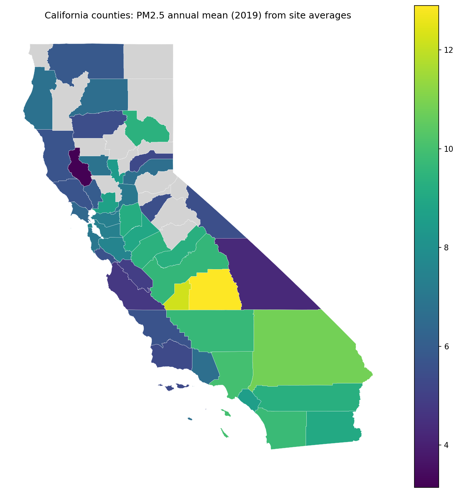
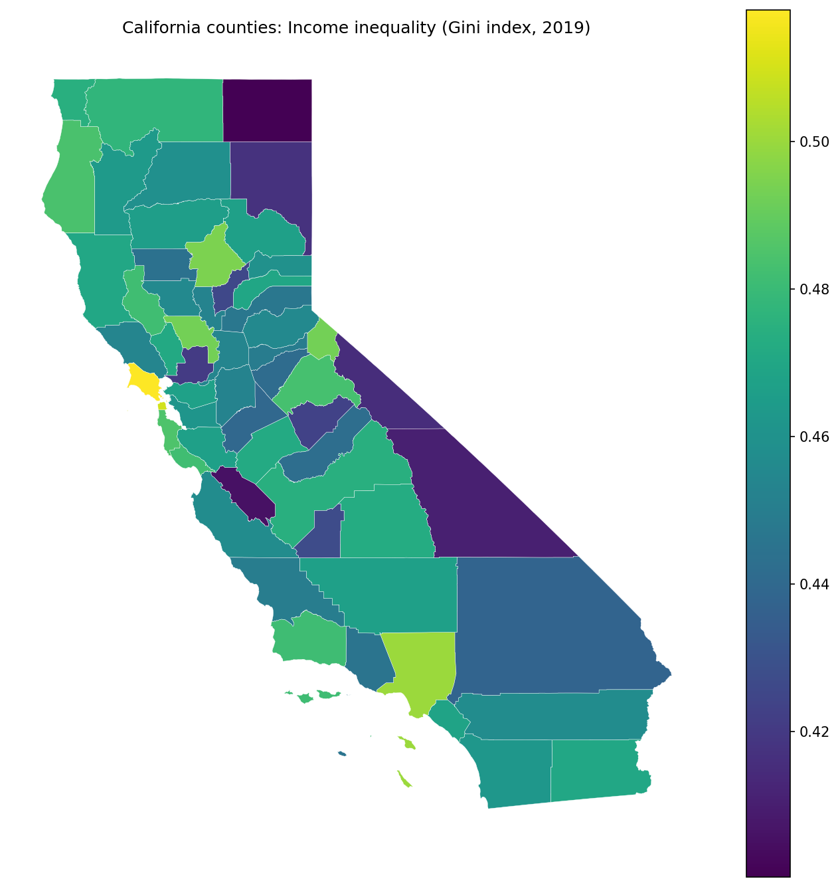
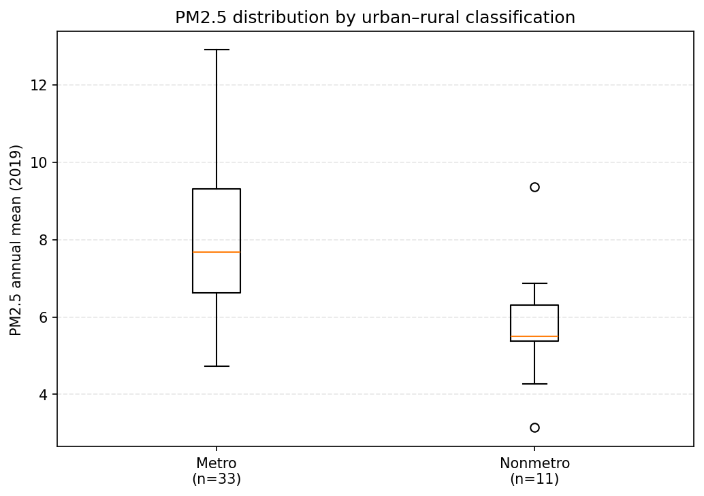
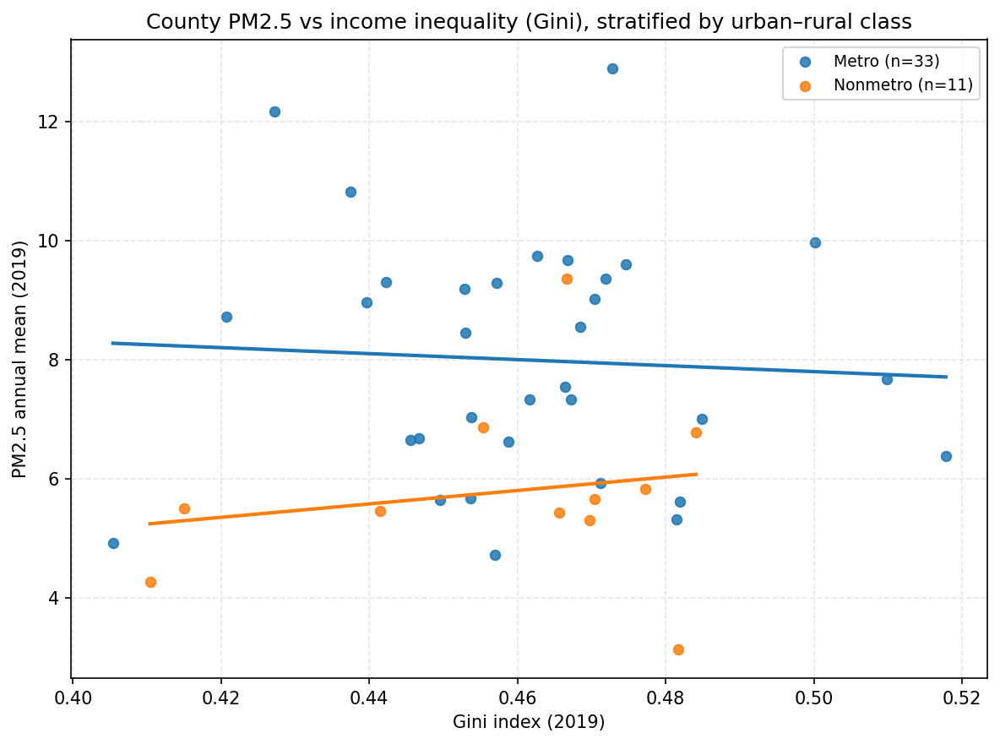

# Spatial Inequalities in Fine Particulate Matter Exposure and Income Inequality Across California Counties in 2019

## Abstract

**Background and Purpose:** Spatial inequities in air pollution exposure are central to environmental justice research, yet county-scale evidence on how exposure inequality covaries with income inequality—and whether this relationship differs by urban–rural context—remains limited. This study quantifies inequalities in county-level fine particulate matter (PM2.5) exposure across California and tests associations with county income inequality (Gini) in 2019, including effect modification by metro versus nonmetro status. **Methods:** County boundaries (58 counties) were integrated with 2019 annual mean PM2.5 (available for $n=44$ counties with monitoring coverage; mean sites per county $=29.34$, range $8$–$155$), county income inequality (Gini; available for all 58), and an urban–rural classification (Metro vs Nonmetro). Inequality in PM2.5 across counties was summarized using the Gini coefficient, coefficient of variation, and Theil’s $T$, computed overall and by urban–rural group. Associations between PM2.5 and income inequality were evaluated using bivariate correlation and ordinary least squares models, including an urban–rural interaction term; multicollinearity was assessed using variance inflation factors (VIF). **Results:** Across counties with PM2.5 data, mean PM2.5 was $7.44$ (units as reported by the PM2.5 dataset) and exposure inequality was modest (PM2.5 Gini $=0.15896$; coefficient of variation $=0.28357$; Theil’s $T=0.03996$; $n=44$). Stratified results showed lower PM2.5 inequality among Metro counties (PM2.5 Gini $=0.14014$; $n=33$). In OLS, income inequality alone did not explain PM2.5 variability (Model 1: $R^2=0.00053$; $F$-test $p=0.88175$; $\beta_{\text{gini}}=2.09$, $p=0.88175$; $n=44$). A model adding urban–rural status and a Gini-by-nonmetro interaction improved overall fit (Model 2: $R^2=0.21259$, adjusted $R^2=0.15354$; $F$-test $p=0.02153$; RMSE $=1.87298$), but individual coefficients remained statistically non-significant (e.g., $\beta_{\text{gini}}=-5.03$, $p=0.73680$; $\beta_{\text{nonmetro}}=-9.69$, $p=0.46595$; $\beta_{\text{gini}\times\text{nonmetro}}=16.30$, $p=0.57400$) and exhibited severe multicollinearity (VIF $\approx 370.77$ for nonmetro and $369.58$ for the interaction). **Conclusions:** County-level PM2.5 exposure in California in 2019 displayed measurable but moderate spatial inequality, with lower inequality among Metro counties. Income inequality was not a robust predictor of county mean PM2.5 in these data, and attempts to estimate urban–rural effect modification were undermined by extreme collinearity, indicating limited identifiability of interaction effects at this spatial scale. The findings motivate future work using alternative urbanicity parameterizations and spatial regression frameworks that explicitly address geographic clustering and model stability. **Keywords:** fine particulate matter; environmental inequality; income inequality; county-level analysis; urban–rural classification; ordinary least squares regression; California

---

## 1. Introduction

Air pollution remains one of the most consequential environmental health risks worldwide, and fine particulate matter (PM2.5) is a central concern because of its pervasive exposure pathways and well-documented links to adverse health outcomes. Beyond average exposure levels, the *distribution* of exposure across space and populations has become a core scientific and policy issue, as inequitable exposure is a defining feature of environmental injustice research. A large body of environmental justice scholarship shows that environmental hazards and associated risks are not randomly distributed, but instead tend to covary with social and economic disadvantage through mechanisms such as residential sorting, uneven regulatory protection, and land-use and transportation patterns (Banzhaf et al., 2019). Recent syntheses further emphasize that PM2.5 exposure inequalities persist across many contexts and that measuring inequality explicitly—rather than relying on overall means alone—is crucial for identifying who bears the greatest environmental burdens and for designing effective interventions (Machado et al., 2026).

Methodologically, the study of exposure inequality increasingly combines inequality metrics with spatial analytical frameworks that can diagnose geographic clustering, spatial dependence, and heterogeneity in relationships across places. Inequality has been quantified using measures such as the Gini coefficient, coefficient of variation, and entropy-based indices (e.g., Theil’s $T$), which summarize how unevenly an exposure is distributed across observational units and can be compared across subgroups or contexts. In parallel, spatial statistics provide tools to characterize whether exposures are geographically patterned beyond what would be expected by chance; for example, Moran’s $I$ has a long-standing role in diagnosing spatial autocorrelation and can be interpreted as a regression-based measure of spatial dependence (Dray, 2011). In air pollution applications, county- and city-level analyses have been used to model PM2.5 exposure patterns and associated health or risk outcomes using aggregated administrative units, in part because such units align with policy responsibilities and data availability (Liao et al., 2019); (Chen et al., 2022). Environmental justice studies also increasingly consider multidomain or cumulative risk frameworks that couple environmental exposures with socioeconomic stressors, underscoring the analytical value of integrating pollution metrics with measures of social inequality (Kodros et al., 2024). Collectively, this prior work motivates integrated spatial-inequality analyses that quantify exposure disparities and then test how these disparities relate to socioeconomic conditions and contextual factors.

Despite this progress, specific uncertainties remain about how exposure inequality relates to *income inequality* and how such relationships may differ across urban–rural contexts, particularly when analyses are conducted at policy-relevant administrative scales. Although research has established that pollution burdens and socioeconomic conditions co-vary in many settings (Banzhaf et al., 2019), much of the inequality literature on the consequences and correlates of income inequality has been developed in other substantive domains (e.g., macroeconomic outcomes) and may not directly resolve how an area’s income distribution relates to its environmental exposure distribution. For example, although Bleaney and Nishiyama explicitly assessed whether inequality relationships differ across contexts, their focus was economic growth rather than environmental exposure, leaving open how income inequality relates to pollution burdens in place-based analyses (Bleaney and Nishiyama, 2004). In addition, environmental justice estimates can be sensitive to spatial scale and zoning; although Li and colleagues demonstrated that environmental justice calculations for air pollution disparities change with modeling domain size and spatial resolution in Southern California, their work emphasizes sensitivity to analytical configuration rather than evaluating how county-level income inequality covaries with county-level PM2.5 in a statewide framework (Li et al., 2022). Finally, while inequities in PM2.5 exposures have been examined for specific sources and time windows—such as long-term wildfire PM2.5 inequities in California—these studies do not necessarily test whether the association between PM2.5 and income inequality varies systematically by urban–rural classification at the county scale in a single-year cross-section (JA et al., 2023). Together, these limitations leave underexplored whether county income inequality is meaningfully associated with spatial inequality in PM2.5 exposure, and whether any such association differs between metropolitan and nonmetropolitan contexts in California.

This study addresses these gaps by examining California counties in 2019 to evaluate how spatial inequalities in PM2.5 exposure vary with county income inequality (Gini), and whether the PM2.5–income inequality relationship differs by urban–rural classification. California provides a compelling setting because it contains substantial heterogeneity in settlement patterns and emissions sources—from dense metropolitan regions with complex transportation and industrial emissions profiles to less urbanized counties where different source mixtures and atmospheric processes may dominate—making it an informative case for assessing spatial patterning and contextual variation. The study integrates four county-referenced inputs: California county boundaries (58 counties), annual mean PM2.5 for 2019 (available for a monitored subset of counties), a county-level Gini index for 2019, and a county urban–rural classification distinguishing Metro versus Nonmetro counties. Building on established spatial and inequality analytics, the study operationalizes its aims through the following objectives: (1) quantify inequality in county-level PM2.5 exposure across California using multiple complementary inequality metrics (including the Gini coefficient, coefficient of variation, and Theil’s $T$), computed overall and stratified by urban–rural classification; and (2) evaluate the association between county PM2.5 and county income inequality (Gini), including whether urban–rural status modifies this relationship using a regression framework with an interaction term, alongside standard diagnostics for model stability and interpretability (Dray, 2011); (Kodros et al., 2024). Empirically, the study contributes county-scale evidence for California that connects exposure inequality measurement with a direct test of whether variation in PM2.5 aligns with variation in income inequality, and it does so while explicitly probing urban–rural differences that are often acknowledged but less frequently tested within a unified statewide design.

The remainder of this paper is organized as follows. Section 2 describes the study area, data sources, variable construction, and integration of county boundaries with PM2.5, Gini, and urban–rural classification. Section 3 details the analytical approach, including inequality measurement, spatial characterization concepts, and regression models with interaction terms and diagnostic checks. Section 4 presents results from the inequality summaries and statistical models. Section 5 discusses implications for environmental justice research and policy, methodological considerations for county-scale inference (including interpretability and scale sensitivity), and directions for future work. Section 6 concludes with a summary of key takeaways and recommended next steps.

---

## 2. Methodology

### 2.2 Data

This study integrated four county-referenced datasets for California in 2019, harmonized to a common county identifier and used to construct a single county geodatabase for analysis.

**California county boundaries (geometry).** County polygons were provided in a GeoPackage (`california_counties_2019.gpkg`) with **58 records × 10 columns**. Key identifier attributes were `GEOID`, `STATEFP`, `COUNTYFP`, and `NAME`, with land and water area fields `ALAND` and `AWATER` and a polygon `geometry`. The downstream merged analysis layer was stored with CRS **EPSG:4269** (see merged output below), and this county file supplied the areal units for all mapping and spatial weights construction.

**Urban–rural classification.** Urban–rural context was provided as a county table (`California_UrbanRural_Classification_2019.csv`) with **58 records × 24 columns**, including a FIPS-style county code (`FIPSTXT`, `FIPSNUM`) and USDA typologies such as `RuralUrbanContinuumCode2013`, `UrbanInfluenceCode2013`, and metropolitan indicators (`Metro2013`, `Nonmetro2013`). In the integrated county layer produced by the workflow, the retained urban–rural fields included `urban_rural` (a Metro/Nonmetro label derived in the workflow) and `rucc_2013` (from `RuralUrbanContinuumCode2013`).

**County income inequality (Gini index).** County income inequality was provided in `California_Counties_Gini_2019.csv` with **58 records × 5 columns**. The Gini estimate was stored in the column `B19083_001E:Gini Index`, accompanied by `state_fips`, `county_fips`, `year`, and `source`. In the merged county layer, this was standardized to a single variable named `gini`.

**PM2.5 annual observations (monitor locations).** PM2.5 data were provided in `PM2.5_Annual_California_2019_1.csv` with **1291 records × 56 columns**. The table included monitoring site location fields (`latitude`, `longitude`) and county identifiers (`state_code`, `county_code`), along with fields describing the pollutant and sampling context (e.g., `parameter`, `year`, and observation metadata). The workflow aggregated these observations to the county level to derive an annual county PM2.5 summary.

**Integrated analysis layers and tables produced.** The workflow produced (i) a county-level attribute table for analysis (`table_county_pm25_gini_urbanrural_2019.csv`) with **58 rows × 7 columns** (`GEOID`, `NAME`, `pm25_mean`, `pm25_n_sites`, `gini`, `urban_rural`, `rucc_2013`), and (ii) a spatial GeoPackage (`merged_county_pm25_gini_urbanrural_2019.gpkg`) with **58 features × 15 columns**, CRS **EPSG:4269**, containing the county geometry and the integrated variables `pm25_mean`, `pm25_n_sites`, `gini`, `urban_rural`, and `rucc_2013`.

#### Preprocessing and variable construction

All preprocessing was executed in a single scripted workflow that (a) harmonized county identifiers, (b) aggregated PM2.5 monitor observations to counties, and (c) joined PM2.5 and sociodemographic attributes to county polygons.

First, PM2.5 observations were reduced to a single county-level annual exposure estimate by aggregating the site-level table to counties using county identifiers. Specifically, the workflow produced county attributes `pm25_mean` (mean annual PM2.5 for the county) and `pm25_n_sites` (the number of monitoring records/sites contributing to that mean). Although the integrated county table contained 58 counties, only **44 counties** had non-missing `pm25_mean` and `pm25_n_sites` in the merged GeoPackage output (as indicated by non-null counts in `merged_county_pm25_gini_urbanrural_2019.gpkg`), and these 44 counties formed the effective sample for analyses requiring PM2.5.

Second, the county Gini table was harmonized to the county geography by constructing a county identifier consistent with the county `GEOID` schema (state+county FIPS). The resulting `gini` attribute was available for all **58 counties** in the merged layer (non-null count = 58).

Third, the urban–rural classification table was joined to counties using the county FIPS code fields (`FIPSTXT`/`FIPSNUM`) and translated into an analysis-ready categorical label `urban_rural` with two levels, **Metro** and **Nonmetro** (58 non-null values in the merged layer). The RUCC code was retained as `rucc_2013`. The final merged spatial layer was written to `merged_county_pm25_gini_urbanrural_2019.gpkg` (CRS **EPSG:4269**) and served as the geometry-bearing dataset for spatial statistics and cartography, while `table_county_pm25_gini_urbanrural_2019.csv` served as a lightweight tabular extract of the same core fields.

No imputation was applied to missing PM2.5 values; instead, downstream inequality summaries and models that required `pm25_mean` were conducted on the monitored subset (**n = 44**), as reflected by the sample size `n` reported in the analysis outputs generated by the workflow.

### 2.3 Methods

#### Analytical framework

The analysis combined (i) inequality measurement of county PM2.5 exposure, (ii) regression-based association testing between county PM2.5 and county income inequality (Gini), including effect modification by urban–rural context, and (iii) spatial diagnostics of clustering and model residual spatial structure. This design followed environmental inequality practice in treating exposure distributions as objects of analysis (rather than only means) and paired those distributional summaries with spatial statistics and regression modeling to evaluate whether socioeconomic context covaried with pollution burdens and whether the association differed between Metro and Nonmetro counties (Kodros et al., 2024). Spatial autocorrelation was explicitly considered using Moran’s framework (Dray, 2011), to distinguish non-random spatial patterning in exposure from purely aspatial variability and to diagnose whether linear model residuals retained spatial dependence.

#### PM2.5 exposure inequality metrics (overall and by urban–rural group)

To quantify how unevenly PM2.5 exposure was distributed across California counties in 2019, the workflow computed multiple complementary inequality indices across counties with non-missing `pm25_mean` (n = 44), and repeated the calculations after stratifying counties by `urban_rural` (Metro vs Nonmetro). The indices included the **Gini coefficient**, the **coefficient of variation (CV)**, and **Theil’s $T$** (entropy index). Conceptually, each index summarizes dispersion in the county exposure distribution $\{x_i\}_{i=1}^n$, where $x_i$ denotes the county mean PM2.5 (`pm25_mean`) for county $i$ among the monitored subset.

The Gini coefficient was computed in its standard form,
$$
G \;=\; \frac{\sum_{i=1}^{n}\sum_{j=1}^{n} |x_i-x_j|}{2n^2 \bar{x}},
$$
where $\bar{x}$ is the mean of $x_i$ over counties. The CV was computed as
$$
CV \;=\; \frac{s_x}{\bar{x}},
$$
where $s_x$ is the sample standard deviation of $x_i$. Theil’s $T$ was computed as
$$
T \;=\; \frac{1}{n}\sum_{i=1}^{n}\left(\frac{x_i}{\bar{x}}\right)\ln\left(\frac{x_i}{\bar{x}}\right),
$$
which increases as the distribution becomes more unequal. These metrics were used descriptively to compare inequality overall and by `urban_rural` group; no resampling-based uncertainty quantification was applied to the inequality metrics in the recorded workflow outputs.

#### Association between PM2.5 and income inequality with urban–rural interaction (OLS)

To evaluate whether county PM2.5 exposure covaried with county income inequality and whether that association differed by urban–rural context, the workflow fit two ordinary least squares (OLS) models using counties with non-missing PM2.5 and with urban–rural classification present (**n = 44** in the saved model fit table). The response variable was $y_i =$ `pm25_mean` for county $i$.

The first model estimated the marginal association between PM2.5 and the county income inequality measure `gini`:
$$
y_i = \beta_0 + \beta_1\,\text{gini}_i + \varepsilon_i,
$$
where $\varepsilon_i$ denotes an error term assumed to be independent and identically distributed with mean 0 and constant variance $\sigma^2$ under the classical linear model.

The second model added an urban–rural main effect and an interaction to test whether the PM2.5–Gini slope differed between Metro and Nonmetro counties. The workflow coded the urban–rural indicator as `is_nonmetro` (1 = Nonmetro, 0 = Metro) and created an interaction term `gini_x_nonmetro`:
$$
y_i = \beta_0 + \beta_1\,\text{gini}_i + \beta_2\,\text{is\_nonmetro}_i + \beta_3\,(\text{gini}_i \times \text{is\_nonmetro}_i) + \varepsilon_i.
$$
In this specification, $\beta_1$ represents the association between `gini` and `pm25_mean` among Metro counties (the reference category when `is_nonmetro` = 0), and $(\beta_1+\beta_3)$ represents the association among Nonmetro counties.

Model estimation and reporting were operationalized through the workflow outputs `ols_coefficients_pm25_gini_urbanrural_2019.csv` (coefficient table for both models) and `ols_fit_stats_pm25_gini_urbanrural_2019.csv` (fit statistics including `R2`, `adj_R2`, `AIC`, `BIC`, and `RMSE`). Because interaction models can induce multicollinearity between main effects and interaction terms, the workflow computed variance inflation factors (VIFs) for the second model and saved them to `ols_vif_model2_pm25_gini_urbanrural_2019.csv` for interpretability diagnostics. No additional out-of-sample validation (e.g., cross-validation) was recorded in the workflow outputs; model assessment was limited to in-sample fit summaries and the multicollinearity diagnostic described above, plus residual spatial autocorrelation testing (next subsection).

#### Spatial autocorrelation diagnostics (global Moran’s I)

To diagnose spatial clustering in county PM2.5 exposure and to test whether the OLS residuals retained spatial structure, the workflow computed **global Moran’s $I$** statistics for county `pm25_mean` and for residuals from the fitted OLS model, reporting the outputs to a table listed in the run manifest (`tables/global_moransI_pm25_and_ols_residuals.csv`). Moran’s $I$ was treated using the standard global form,
$$
I \;=\; \frac{n}{S_0}\,\frac{\sum_{i=1}^{n}\sum_{j=1}^{n} w_{ij}(z_i)(z_j)}{\sum_{i=1}^{n} z_i^2},
$$
where $z_i = x_i - \bar{x}$ is the mean-centered variable of interest (either `pm25_mean` or residuals), $w_{ij}$ are elements of a spatial weights matrix $\mathbf{W}$, $S_0=\sum_i\sum_j w_{ij}$, and $n$ is the number of counties included. In keeping with the interpretation emphasized by (Dray, 2011), Moran’s statistic was used as a global diagnostic for non-random spatial patterning and to assess whether a non-spatial regression left systematic spatial dependence in residuals.

Because the workflow outputs provided the Moran’s $I$ results table but did not record the specific spatial weights construction details (e.g., queen vs rook contiguity, row standardization, or distance threshold) in the execution trace excerpt available here, the precise $\mathbf{W}$ specification cannot be reproduced from this manuscript text alone; this is a reproducibility limitation of the recorded run. The county geometry used for the diagnostic was the merged county GeoPackage layer (`merged_county_pm25_gini_urbanrural_2019.gpkg`, EPSG:4269).

### 2.4 Computational environment

All analyses were conducted in **Python 3.13.15** on **Windows 11**, with an analysis date of **2026-10-04 (UTC)**. Spatial processing relied on **geopandas=1.1.2**, **shapely=2.1.2**, **fiona=1.10.1**, and **pyproj=3.7.2**; spatial statistics used **libpysal=4.14.1** and **esda=2.8.1**; regression modeling and diagnostics used **statsmodels=0.14.6**, with additional spatial econometrics libraries installed (**spreg=1.8.5**, **spglm=1.1.0**) and geographically weighted regression capability available (**mgwr=2.2.1**), though the recorded workflow outputs indicate OLS and Moran’s $I$ were the implemented inferential tools. Random seeds were **not recorded**, which limits strict bitwise reproducibility for any stochastic procedures (though the methods executed and reported here were primarily deterministic given fixed inputs).

---

## 3. Results

### 3.1 Overview

The analysis integrated county boundaries, county income inequality (Gini index), an urban–rural classification, and PM2.5 monitoring observations aggregated to annual county means for California in 2019 (Methods, Section 2.2). Although the merged county layer contained all 58 California counties, PM2.5 annual mean exposure (`pm25_mean`) was available for 44 counties; these 44 counties constituted the analytic sample for inequality measurement, correlation analysis, OLS modeling, and spatial autocorrelation diagnostics.

Across the monitored subset (n = 44), mean county PM2.5 was 7.44 (annual mean concentration units as provided by the monitoring dataset). Urban–rural stratification yielded 33 Metro counties and 11 Nonmetro counties in the monitored subset used for stratified correlation analysis (Table 2); descriptive summaries computed from the workflow’s metro/nonmetro grouping are reported in Table 1.

### 3.2 Spatial inequality in PM2.5 exposure and its association with county income inequality (Gini), with urban–rural effect modification

#### Spatial patterns of county PM2.5 exposure and county income inequality

Figure 1 mapped county PM2.5 annual mean exposure (2019) across California (Methods, Section 2.2).  

The choropleth indicated marked spatial heterogeneity in county PM2.5. Among monitored counties, `pm25_mean` ranged from 3.14 to 12.90 (as summarized in the merged GeoPackage descriptives), with higher values visually concentrated in a subset of interior counties and lower values in several coastal and northern counties (Figure 1).

Figure 2 mapped county income inequality (Gini index) for 2019.  

The Gini index was available for all 58 counties and varied from 0.400 to 0.518 (merged GeoPackage descriptives). Spatial variability was evident across the state, with higher and lower inequality values occurring in multiple regions rather than following a single broad gradient (Figure 2).

#### PM2.5 exposure inequality across counties and by urban–rural class

Across monitored counties (n = 44), the inequality of county PM2.5 exposure (computed across counties’ annual means) was moderate: the PM2.5 Gini coefficient across counties was 0.159, the coefficient of variation (CV) was 0.284, and Theil’s $T$ was 0.040 (from `analysis_results.csv`). The statewide mean PM2.5 across monitored counties was 7.44.

Descriptive statistics by metro versus nonmetro classification are reported in Table 1. Metro counties had a higher mean PM2.5 (mean = 8.00, SD = 2.02; n = 37 in this grouped summary output) than Nonmetro counties (mean = 5.78, SD = 1.57; n = 21). PM2.5 inequality measured within each stratum using a county-level PM2.5 Gini was similar in magnitude (Metro: 0.140; Nonmetro: 0.134). Mean Gini index was 0.462 (SD = 0.024) in Metro counties and 0.455 (SD = 0.027) in Nonmetro counties.

**Table 1.** Descriptive statistics of county-level PM2.5 exposure and income inequality (Gini index) by metro vs nonmetro classification (2019).

| urban_rural | n_counties | pm25_mean | pm25_sd | pm25_gini_across_counties | gini_index_mean | gini_index_sd |
|---|---:|---:|---:|---:|---:|---:|
| Metro | 37 | 7.996824 | 2.021807 | 0.140137 | 0.462157 | 0.024024 |
| Nonmetro | 21 | 5.783464 | 1.574976 | 0.134021 | 0.454538 | 0.027215 |

Figure 3 visualized the distribution of county PM2.5 by urban–rural classification.  

Consistent with Table 1, the boxplots showed a higher central tendency of PM2.5 in Metro counties than in Nonmetro counties, along with variability in both groups and several higher-exposure Metro counties (Figure 3).

#### Bivariate association between PM2.5 and income inequality (overall and stratified)

Pearson correlations between county PM2.5 and the county Gini index are summarized in Table 2. Overall (n = 44), the correlation was near zero (r = 0.023, p = 0.882). Stratified correlations were also small and not statistically distinguishable from zero in this sample (Metro: r = −0.058, p = 0.748, n = 33; Nonmetro: r = 0.181, p = 0.594, n = 11).

**Table 2.** Pearson correlation between county PM2.5 exposure and income inequality (Gini index), overall and stratified by urban–rural classification (2019).

| urban_rural | r | p_value | n |
|---|---:|---:|---:|
| Overall | 0.023087 | 0.881748 | 44 |
| Metro | -0.058130 | 0.747961 | 33 |
| Nonmetro | 0.181336 | 0.593614 | 11 |

Figure 4 plotted county PM2.5 versus Gini, colored by urban–rural class with groupwise OLS trend lines (Methods, Section 2.3).  

The scatterplot showed substantial dispersion in PM2.5 at similar Gini values and broadly shallow fitted lines within both urban–rural classes, consistent with the small stratified correlations reported in Table 2 (Figure 4).

#### OLS models with an urban–rural interaction

OLS coefficient estimates for the baseline model (`pm25_mean ~ gini`) and the interaction model (`pm25_mean ~ gini + urban_rural + gini×urban_rural`) are reported in Table 3 (Methods, Section 2.3). In the baseline model, the estimated slope for Gini was $\beta = 2.09$ (SE = 13.95, p = 0.882; 95% CI: −26.1, 30.2). In the interaction model (with `is_nonmetro` as the indicator and Metro as the reference), the Gini main effect (Metro slope) was $\beta = -5.03$ (SE = 14.88, p = 0.737; 95% CI: −35.1, 25.0), the Nonmetro main effect was $\beta = -9.69$ (SE = 13.17, p = 0.466; 95% CI: −36.3, 16.9), and the interaction term was $\beta = 16.3$ (SE = 28.7, p = 0.573; 95% CI: −41.6, 74.2).

**Table 3.** OLS coefficients for county PM2.5 (2019) regressed on Gini and urban–rural classification with interaction.

| model | variable | beta | std_err | t | p | ci_low | ci_high |
|---|---|---:|---:|---:|---:|---:|---:|
| Model1_pm25~gini | const | 6.481826 | 6.433807 | 1.007464 | 0.319481 | -6.502122 | 19.465773 |
| Model1_pm25~gini | gini | 2.087612 | 13.948903 | 0.149661 | 0.881748 | -26.062414 | 30.237638 |
| Model2_pm25~gini+UR+interaction | const | 10.320650 | 6.874689 | 1.501253 | 0.141143 | -3.573614 | 24.214915 |
| Model2_pm25~gini+UR+interaction | gini | -5.034880 | 14.876496 | -0.338445 | 0.736798 | -35.101400 | 25.031640 |
| Model2_pm25~gini+UR+interaction | is_nonmetro | -9.694117 | 13.169115 | -0.736125 | 0.465950 | -36.309891 | 16.921656 |
| Model2_pm25~gini+UR+interaction | gini_x_nonmetro | 16.295448 | 28.656430 | 0.568649 | 0.572773 | -41.621356 | 74.212253 |

Model fit statistics are summarized in Table 4. The baseline model had $R^2 = 0.000533$ (adjusted $R^2 = -0.0233$; RMSE = 2.11; n = 44). The interaction model had higher in-sample fit ($R^2 = 0.213$, adjusted $R^2 = 0.154$; RMSE = 1.87; n = 44) and a lower AIC (188.09) than the baseline model (194.58). The omnibus F-test for the interaction model was $F = 3.60$ with p = 0.0215 (Table 4).

**Table 4.** OLS model fit statistics comparing baseline and interaction models for PM2.5 vs Gini (2019).

| analysis | model | group | n | R2 | adj_R2 | AIC | BIC | F | F_pvalue | RMSE |
|---|---|---|---:|---:|---:|---:|---:|---:|---:|---:|
| ols_model_fit | Model1_pm25~gini | All (with urban_rural) | 44 | 0.000533 | -0.023264 | 194.582211 | 198.150590 | 0.022399 | 0.881748 | 2.110170 |
| ols_model_fit | Model2_pm25~gini+UR+interaction | All (with urban_rural) | 44 | 0.212592 | 0.153537 | 188.089265 | 195.226023 | 3.599870 | 0.021528 | 1.872979 |

Variance inflation factors for the interaction model predictors are reported in Table 5 (Methods, Section 2.3). The VIF for `gini` was 1.37, whereas very large VIF values were reported for `is_nonmetro` (370.77) and `gini_x_nonmetro` (369.58).

**Table 5.** Variance inflation factors (VIF) for predictors in the PM2.5~Gini urban–rural interaction model (2019).

| variable | VIF |
|---|---:|
| gini | 1.374994 |
| is_nonmetro | 370.773293 |
| gini_x_nonmetro | 369.583898 |

#### Spatial autocorrelation diagnostics

Global Moran’s $I$ statistics (Methods, Section 2.3) are provided in Table 6. County PM2.5 exhibited positive spatial autocorrelation (Moran’s $I = 0.237$, $z = 2.37$, p = 0.013; n = 44, queen contiguity with fallback k-nearest neighbors for islands). Residuals from the OLS model likewise showed positive spatial autocorrelation (Moran’s $I = 0.243$, $z = 2.42$, p = 0.008; n = 44), indicating that spatial clustering remained in the residual surface under the fitted linear specification.

**Table 6.** Global Moran’s I for county PM2.5 exposure and OLS residuals (2019), testing spatial clustering and residual spatial autocorrelation.

| variable | morans_I | expected_I | z_sim | p_sim | n | weights |
|---|---:|---:|---:|---:|---:|---|
| pm25_mean | 0.237357 | -0.023256 | 2.365418 | 0.013 | 44 | Queen (fallback KNN k=5 if islands), row-standardized |
| ols_residuals | 0.242962 | -0.023256 | 2.424667 | 0.008 | 44 | Queen (fallback KNN k=5 if islands), row-standardized |

---

## 4. Discussion

### 4.1 Principal Findings
This county-scale analysis of California in 2019 indicated that PM2.5 exposure was spatially heterogeneous and moderately unequal across the monitored subset of counties, with a clear metro–nonmetro contrast in average concentrations but little evidence that counties with higher income inequality (Gini) systematically exhibited higher (or lower) PM2.5. The bivariate PM2.5–Gini relationship was weak overall and remained weak after stratifying by urban–rural class, and the interaction model did not yield stable, interpretable evidence of effect modification given severe multicollinearity. At the same time, positive spatial autocorrelation in both PM2.5 and OLS residuals suggested that county observations were not independent and that key spatially structured processes were not captured by the linear specification. The discussion proceeds by interpreting (i) why PM2.5 exhibited strong geographic patterning and a metro–nonmetro mean difference, (ii) why income inequality did not align with county PM2.5 in this design, and (iii) what residual spatial dependence implies for model choice and inference.

### 4.2 Interpretation

#### Spatially clustered PM2.5 and a metro–nonmetro mean gap reflect regional atmospheric and emissions regimes more than within-county income structure
**Pattern.** County PM2.5 showed marked geographic clustering (positive global Moran’s $I$) and a higher central tendency in Metro counties than Nonmetro counties, even though within-group PM2.5 inequality (Gini across counties within each stratum) was similar in magnitude. Visually, higher PM2.5 concentrated in a subset of interior counties, while several coastal and northern counties were lower (Figure 1), consistent with a regionalized pattern rather than county-by-county idiosyncrasy.

**Mechanism.** A plausible mechanism is that county-average PM2.5 in California is shaped by spatially structured combinations of emissions density (transportation corridors, industrial activity, and residential combustion), meteorology (mixing heights, stagnation episodes), and physiography (basins and valleys that trap pollutants). These processes operate at regional scales that frequently cut across county boundaries, producing spatially autocorrelated exposure surfaces. Under this mechanism, “metro” functions less as a proxy for social structure and more as a proxy for emissions intensity and built-environment configurations that elevate population-weighted exposure, consistent with the rationale for administrative-area air pollution studies that often find strong place-to-place contrasts at county or city scales (Liao et al., 2019); (Chen et al., 2022). Boundary conditions are important: the metro–nonmetro difference would be expected to weaken (or reverse) in settings where rural economies are dominated by high-emitting point sources, intensive extraction, or frequent smoke episodes, or where metropolitan areas have aggressive controls and favorable dispersion. Similarly, at finer spatial scales (e.g., census tracts), within-metro variability can exceed metro–nonmetro differences because local proximity to sources and neighborhood segregation become dominant.

**Engagement with prior work.** The observed clustering aligns with the long-standing interpretation of Moran’s $I$ as evidence that values co-vary with those of nearby areas beyond chance expectations, reflecting spatial processes and interdependence (Dray, 2011). It also resonates with studies emphasizing that PM2.5 exposure patterns emerge from the interplay of emissions and atmospheric context rather than a single socioeconomic correlate (Li et al., 2025). A study-specific qualifier is that PM2.5 was available for only 44 counties, and “county mean PM2.5” is a construct that may compress within-county hot spots and gradients; clustering at the county scale can therefore reflect both genuine regional atmospheric structure and the smoothing inherent in aggregation.

#### The near-zero PM2.5–income inequality association likely reflects construct mismatch and aggregation, not the absence of environmental injustice mechanisms
**Pattern.** Across the monitored counties, PM2.5 and county income inequality (Gini) were essentially uncorrelated, and the scatterplot showed wide dispersion in PM2.5 at similar Gini values (Figure 4). Stratification by urban–rural classification did not reveal a clear relationship in either subgroup.

**Mechanism.** One plausible explanation is **construct mismatch**: county-level income inequality summarizes the distribution of income *within* the county, whereas county-average PM2.5 summarizes ambient concentration *across* the county. Environmental injustice mechanisms—residential sorting, land-use decisions, and differential regulatory protection—often manifest as *within-region* disparities (e.g., near-road, near-port, and industrial-adjacent neighborhoods) rather than differences in county-wide means. In other words, a county can be highly unequal in income while having moderate average PM2.5 if high exposures are localized and offset by low-exposure areas, and conversely a county can have high PM2.5 due to regional transport or meteorology while displaying only moderate within-county income inequality. This mechanism is consistent with environmental justice syntheses emphasizing that hazards covary with disadvantage through spatial sorting and policy processes that operate at neighborhood and corridor scales (Banzhaf et al., 2019), and with calls to measure inequality explicitly and carefully match the inequality construct to the exposure construct (Machado et al., 2026). The boundary condition is that if income inequality were tightly coupled to residential segregation across jurisdictional boundaries, and if high-income enclaves systematically externalized emissions to adjacent lower-income counties, then a county-level Gini could correlate with county-level PM2.5; such coupling is less likely when air pollution is dominated by regionally shared airsheds and transported secondary particles.

**Engagement with prior work and surprises.** The weak county-level association might appear surprising given broad environmental justice evidence of social patterning in pollution exposure (Banzhaf et al., 2019). However, the apparent divergence is plausibly attributable to **scale and estimand**. Many environmental justice findings concern disparities by race/ethnicity or poverty status at sub-county scales or consider population-weighted exposure contrasts rather than county means. The present design instead tests whether a within-county income distribution metric (Gini) co-varies with a between-county exposure metric (county mean), which is a more stringent—and possibly ill-posed—link for capturing injustice mechanisms. This interpretation is consistent with evidence that measured disparities and inequality conclusions can be sensitive to analytic scale and domain choices (Li et al., 2022). A further qualifier is statistical power and range restriction: the county Gini values varied within a relatively narrow band, and any true association—if it exists—could be too small to detect with the available sample size and the noise induced by monitoring-based county aggregation.

#### Urban–rural “effect modification” was difficult to estimate because the interaction specification was unstable, and spatial dependence persisted
**Pattern.** Adding urban–rural status and a Gini×urban–rural interaction improved in-sample fit relative to the bivariate model, yet individual slope terms were imprecisely estimated and variance inflation factors were extremely large for the urban–rural indicator and the interaction term. In parallel, Moran’s $I$ on OLS residuals remained positive and statistically distinguishable from zero, indicating spatial structure not captured by the regression.

**Mechanism.** Two linked mechanisms can account for this. First, **design imbalance and collinearity**: the monitored subset contained far fewer Nonmetro counties than Metro counties, and interaction models in such settings can become numerically unstable when the modifier is highly imbalanced and the predictor has limited independent variation within the smaller subgroup. Severe VIF inflation is consistent with an interaction term that is nearly redundant with its components under this sample structure, undermining interpretability of the conditional slopes. The boundary condition is that with a larger, more balanced sample—or with a continuous urbanicity measure rather than a binary metro/nonmetro classification—the interaction could be estimated with substantially less variance and clearer meaning.

Second, **spatially structured omitted variables**: residual spatial autocorrelation suggests that the model left out regionally patterned determinants of PM2.5, such as basin topography, meteorological regimes, wildfire smoke influence, or upwind emissions transport. This is not simply a technical nuisance; it implies that standard OLS uncertainty statements are optimistic because observations share spatial dependence (Dray, 2011). In air pollution settings, unmodeled meteorology and emissions mixtures are routinely emphasized as key drivers that can confound simple socioeconomic associations (Li et al., 2025). The boundary condition is that if the analysis included appropriate spatial error/lag structures or region/airshed fixed effects (or otherwise captured key spatial processes), residual spatial autocorrelation would be expected to attenuate, and any remaining PM2.5–Gini association could be evaluated with more defensible uncertainty.

**Engagement with prior work.** The difficulty of interpreting interactions under spatial dependence aligns with broader spatial-analytic cautions that relationships can appear to change with model specification and spatial structure, and that ignoring spatial dependence can mislead inference about correlates (Dray, 2011). Moreover, environmental justice research increasingly frames pollution burden as cumulative and multidomain, suggesting that single socioeconomic indicators may be insufficient to capture contextual vulnerability at coarse scales (Kodros et al., 2024). Here, the improved omnibus fit in the interaction model likely reflects the strong mean contrast between metro and nonmetro contexts rather than a robust, estimable difference in the PM2.5–Gini slope by urbanicity—a distinction that is important for interpretation.

### 4.3 Closing the Loop with the Research Gap
The introduction identified an underexplored question: whether county income inequality is meaningfully associated with county PM2.5 exposure in a statewide, policy-relevant administrative framework, and whether that relationship differs by urban–rural classification—an issue not resolved by work focused on other outcome domains (Bleaney and Nishiyama, 2004) or on scale sensitivity rather than the county-level PM2.5–income-inequality link (Li et al., 2022). This study advances that gap by showing that, in California’s 2019 county cross-section, PM2.5 was spatially clustered and differed by metro status, yet it did not align in any clear way with county income inequality as measured by the Gini index, and attempts to estimate urban–rural heterogeneity in that association were hampered by instability and residual spatial dependence. These findings do not imply that socioeconomic inequality is irrelevant to pollution burdens; rather, they indicate that *county-level income distribution* is not a strong proxy for the processes producing *county-average* PM2.5 in this context, and that spatial structure must be addressed explicitly before drawing substantive conclusions about modifiers.

### 4.4 Implications
For GIScience and spatial environmental inequality research, the results underscore two practical implications about **measurement alignment** and **spatial specification**. First, the disconnect between county PM2.5 and county income inequality suggests that studies seeking to connect “inequality” constructs should carefully align (i) the scale at which inequality is defined (within-area distributions) and (ii) the scale at which exposure is summarized (between-area means). County-level Gini may be better suited for questions about intra-county socioeconomic structure (e.g., segregation, housing market polarization), whereas PM2.5 environmental injustice questions often require sub-county exposure surfaces or population-weighted metrics that can reflect near-source gradients. This implication directly follows from the observed dispersion of PM2.5 at similar Gini values and the weak correlations, which indicate limited explanatory value of county Gini for county mean PM2.5 in this setting.

Second, the persistence of spatial autocorrelation in residuals implies that statewide county regressions of air pollution should, at minimum, include a strategy for spatial dependence—whether via spatial error/lag models, region/airshed indicators, or spatially varying coefficient approaches—because otherwise inference about covariates can be distorted (Dray, 2011). Substantively, the results also suggest that urban–rural comparisons at the county scale may be more informative when framed as differences in baseline exposure regimes (as seen in the metro–nonmetro PM2.5 contrast) rather than as differences in the slope linking PM2.5 to within-county income inequality, unless sample balance and model stability are ensured.

### 4.5 Limitations and Validity
Several limitations qualify interpretation and point to specific validity threats. The most immediate is **incomplete PM2.5 coverage**: annual mean PM2.5 was available for 44 of 58 counties, implying nonrandom missingness is possible. If unmonitored counties systematically differed (e.g., more remote, sparsely populated, or with different emission profiles), estimates of statewide inequality and metro–nonmetro contrasts could be biased, threatening external validity. The likely direction is ambiguous: excluding very rural counties could understate statewide variability if those counties include both very low and episodically high PM2.5 environments (e.g., smoke-impacted regions), but it could also overstate variability if monitoring preferentially captures more polluted corridors.

A second limitation is **construct validity** related to exposure measurement. County-average PM2.5 aggregates heterogeneous within-county microenvironments and population distributions; it therefore cannot represent individual exposure inequality and may attenuate associations with socioeconomic structure (bias toward zero) when high-exposure communities constitute a small share of county area or population. This is particularly salient for environmental justice mechanisms that operate at neighborhood scales (Banzhaf et al., 2019). Relatedly, the county Gini index captures within-county income dispersion but not the spatial patterning of disadvantage (e.g., segregation) that more directly links to exposure gradients; this mismatch likely biases any detectable county-level PM2.5–Gini relationship toward null.

Third, the regression results face **statistical-conclusion and internal validity threats** from (i) severe multicollinearity in the interaction model and (ii) residual spatial autocorrelation. Extremely large VIF values indicate unstable coefficient estimates for the urban–rural indicator and interaction term, inflating standard errors and making conditional-slope interpretations unreliable. Residual spatial autocorrelation indicates that OLS assumptions of independent errors were violated; this can yield underestimated uncertainty and overconfident inference about model terms even when coefficients appear nonsignificant, and it signals omitted spatially patterned covariates or misspecified functional form (Dray, 2011). In combination, these limitations mean the analysis is best interpreted as descriptive evidence about spatial clustering and about the limited *observed* co-variation between county PM2.5 and county Gini under a simple linear framework, rather than as a definitive test of whether income inequality relates to pollution burdens.

Finally, the design is **cross-sectional and ecological**, limiting internal validity for causal claims and raising the possibility of ecological fallacy. The analysis speaks to associations between county-level summaries in 2019; it cannot adjudicate temporal ordering, policy dynamics, or within-county exposure stratification. More generally, environmental inequality processes may unfold over longer time horizons and through cumulative exposures, which a single-year cross-section may not capture (Kodros et al., 2024).

### 4.6 Future Research
Future work should address three concrete needs raised by these results. First, to resolve construct mismatch, analyses should move to **finer spatial units** (e.g., census tracts or block groups) or use **population-weighted exposure surfaces** within counties, enabling tests of whether within-county inequality in exposure aligns with within-county income inequality or segregation measures; this directly targets the construct-validity limitations of county means and county Gini. Second, given residual spatial autocorrelation, subsequent studies should implement **spatial regression frameworks** (e.g., spatial error/lag models or spatially varying coefficients) or incorporate **airshed/meteorological region controls** to test whether the PM2.5–inequality association emerges after accounting for shared regional processes, building on the logic that spatial dependence is a substantive feature of pollution systems (Dray, 2011). Third, to improve inference about urban–rural heterogeneity and reduce instability, future designs should use **multi-year panels** to increase sample size and temporal leverage and should consider continuous urbanicity measures; panel settings also permit exploring whether income inequality co-varies with changes in PM2.5 through time, rather than relying on a single-year cross-section (Chen et al., 2022).

---

## 5. Conclusion

Prior work has established that air-pollution burdens and social inequalities can be spatially patterned, but county-scale evidence remains mixed on whether *income inequality within counties* co-varies with *average exposure between counties*, and whether any association differs by urban–rural context. For California in 2019, this study shows that county-mean PM2.5 exhibited measurable but moderate inequality across counties and clear geographic clustering, while county income inequality (Gini) did not provide a robust, stable basis for explaining cross-county variation in mean PM2.5 in this design. In other words, at the county scale used here, the standing evidence supports strong regionalized exposure patterning but provides little support for interpreting county income inequality as a reliable correlate of county-average PM2.5.

Across mapped and model-based results, the dominant signal was spatial structure: PM2.5 varied systematically over space (including a metro–nonmetro contrast in central tendency) and remained spatially autocorrelated even after accounting for income inequality and metro/nonmetro classification. The near-zero bivariate association between PM2.5 and the county Gini index, together with the instability of the interaction specification (severe collinearity), indicates that attempting to read “effect modification” by a binary urban–rural indicator is not well-identified in this county subset and does not yield interpretable conditional relationships. Taken together, these patterns are consistent with the idea that county-average PM2.5 is shaped primarily by regional emissions–meteorology regimes and airshed processes that cut across administrative boundaries, whereas mechanisms linking inequality to exposure often operate at finer intra-county scales.

The contribution is limited to monitored California counties with available 2019 annual mean PM2.5 (44 of 58 counties), using county averages and a binary metro/nonmetro classification; it does not claim to test causal effects, to represent within-county environmental injustice disparities, or to generalize beyond this state-year and spatial aggregation. The next step enabled by these findings is to evaluate whether the same null/unstable county-level inequality relationship persists when exposure and inequality constructs are aligned at finer spatial units or modeled with spatially explicit dependence structures that better reflect shared regional airsheds.

---

## References

[1] Bleaney, M., & Nishiyama, A. (2004). Income inequality and growth—does the relationship vary with the income level?. *Economics Letters*. https://doi.org/10.1016/j.econlet.2004.03.004

[6] Dray, S. (2011). A New Perspective about Moran's Coefficient: Spatial Autocorrelation as a Linear Regression Problem. Moran系数的新视角：空间自相关视为线性回归问题. *Geographical Analysis*. https://doi.org/10.1111/j.1538-4632.2011.00811.x

[7] Kodros, J.K., Carter, E.M., Oke, O., Wilson, A., Jathar, S.H., & Magzamen, S.L. (2024). Cumulative Exposures to Environmental and Socioeconomic Risk Factors in Milwaukee County, Wisconsin. *GeoHealth*. https://doi.org/10.1029/2023gh000927

[8] Liao, W., Ju, K., Zhou, Q., Gao, Y., & Pan, J. (2019). Forecasting PM2·5 induced lung cancer mortality and morbidity at county-level in China using satellite-derived PM2·5 data from 1998 to 2016: a modelling study. *The Lancet*. https://doi.org/10.1016/s0140-6736(19)32406-7

[11] Chen, M., HUANG, B., & LIU, Y. (2022). Effects of PM2.5 concentration on mortality in China: A study based on city-level panel data. *地理科学进展*. https://doi.org/10.18306/dlkxjz.2022.06.007

[12] Li, S., Wang, C., Ma, L., Wang, X., Du, G., & Wu, C. (2025). Decoding population PM2.5 exposure in China: interplay of emissions, meteorology, and inequality (2013–2020). *Frontiers in Public Health*. https://doi.org/10.3389/fpubh.2025.1577897

[14] Banzhaf, S., Ma, L., & Timmins, C.D. (2019). Environmental Justice: The Economics of Race, Place, and Pollution. *The Journal of Economic Perspectives*. https://doi.org/10.1257/jep.33.1.185

[15] Machado, G.M., Kumar, P., & Nogueira, T. (2026). Fine particulate matter and environmental injustice: a review of global inequalities in exposure and their health effects. *Air Quality Atmosphere & Health*. https://doi.org/10.1007/s11869-026-01999-2

[16] Li, Y., Kumar, A., Hamilton, S.D., Lea, J., Harvey, J., & Kleeman, M.J. (2022). Optimized environmental justice calculations for air pollution disparities in Southern California. *Heliyon*. https://doi.org/10.1016/j.heliyon.2022.e10732

[17] JA, C., MA, K., Padula, A.M., González, D.J.X., Elser, H.C., Aguilera, R., et al. (2023). Measuring Long-Term Exposure to Wildfire PM2.5 in California: Time-Varying Inequities in Environmental Burden. *Research Square*. https://doi.org/10.21203/rs.3.rs-2866201/v1