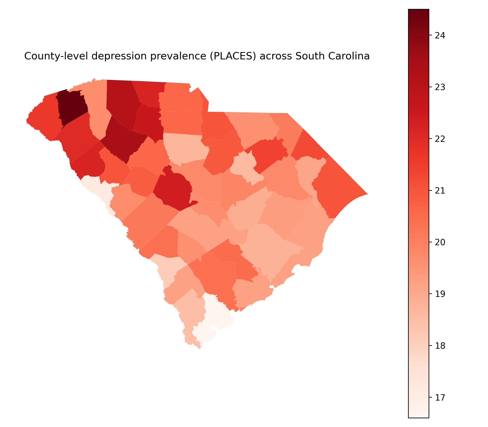
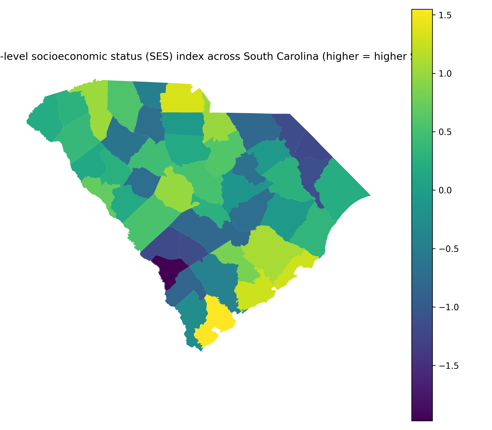
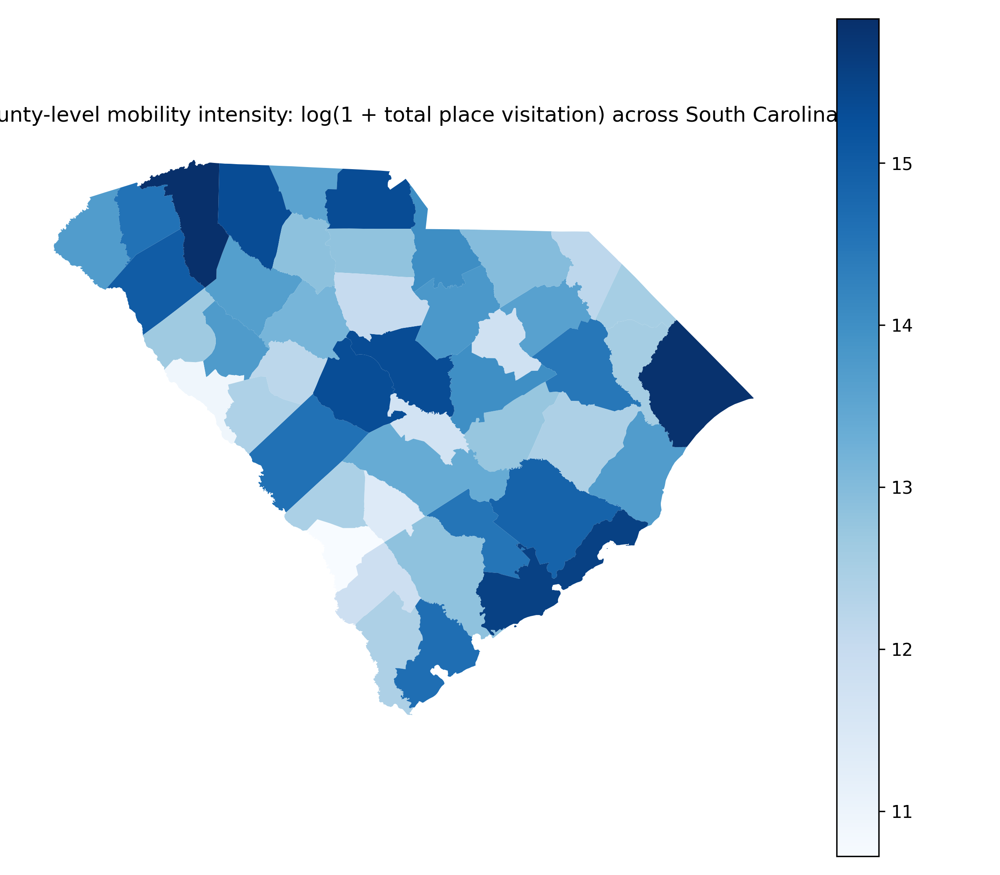
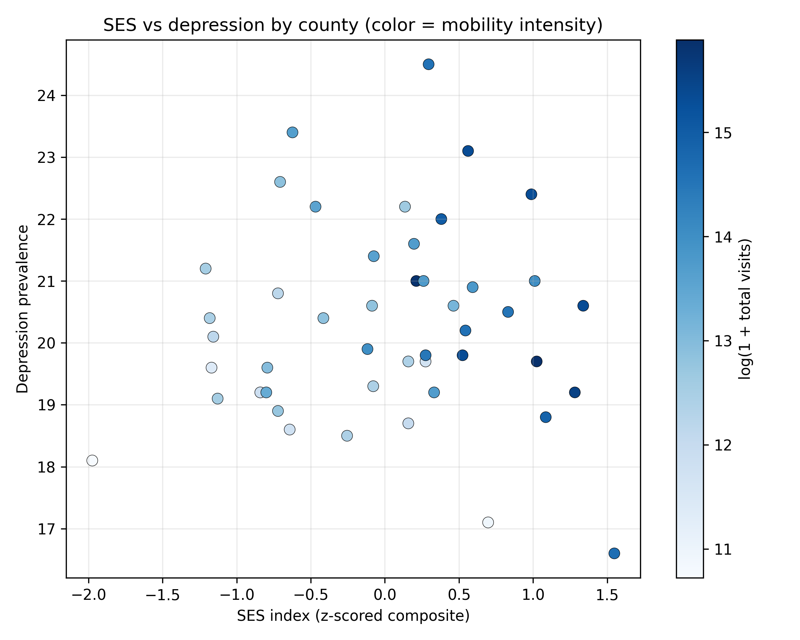

# Spatial Mediation of Socioeconomic Status–Depression Associations by Place Visitation Across South Carolina Counties

## Abstract

**Background and Purpose:** County-level depression prevalence exhibits pronounced geographic variability, yet the extent to which everyday mobility (place visitation) explains socioeconomic gradients in depression remains unclear. This study evaluates whether spatial patterns of mobility mediate the association between neighborhood socioeconomic status and depression prevalence across South Carolina counties. **Methods:** County-level depression prevalence was compiled from the PLACES dataset and linked to a standardized socioeconomic status (SES) index derived from American Community Survey indicators, alongside aggregated place visitation metrics from points-of-interest visitor data for all 46 counties in South Carolina. Two candidate mediators were tested using ordinary least squares mediation models: (i) total place visitation intensity (log-transformed total visits) and (ii) mobility diversity (entropy of visitation distribution). Model performance was summarized with $R^2$, and spatial dependence was assessed using Moran’s $I$ on model residuals for the direct-plus-mediator specification. **Results:** Across counties ($n=46$), SES was strongly and inversely associated with depression prevalence, with a total effect of $c=-0.943$ (depression percentage-point change per one-unit SES increase). Mediation through total visitation intensity was not supported: SES positively predicted log visitation ($a=0.576$) and visitation weakly predicted depression ($b=0.060$), yielding a small, non-significant indirect effect ($ab=0.035$, Sobel $z=0.300$, $p=0.764$) and a negative proportion mediated ($ab/c=-0.037$), consistent with suppression rather than mediation. Mediation through mobility diversity was also non-significant: SES weakly increased entropy ($a=0.015$), while higher entropy related to lower depression ($b=-2.681$), producing $ab=-0.041$ (Sobel $z=-0.680$, $p=0.496$) and a small positive proportion mediated ($ab/c=0.043$). The total-effect model explained substantial variance ($R^2=0.672$), with similar fit after adding mediators ($R^2=0.672$–$0.677$). Residual spatial autocorrelation was not evident (Moran’s $I=0.0147$, $p_{\mathrm{sim}}=0.332$). **Conclusions:** The inverse SES–depression relationship across South Carolina counties was robust, but aggregated place visitation intensity and diversity did not significantly mediate this association. These findings suggest that, at the county scale, mobility-derived visitation metrics capture limited explanatory pathways between structural socioeconomic conditions and mental health, motivating finer-scale or network-sensitive mobility representations and explicitly spatial modeling where warranted. **Keywords:** depression prevalence; socioeconomic status; mobility patterns; mediation analysis; Moran’s I; county-level spatial analysis; South Carolina

---

## 1. Introduction

Depression is a major contributor to population morbidity, yet its prevalence is rarely distributed uniformly across space. In the United States, mental health outcomes exhibit pronounced geographic patterning that aligns with uneven distributions of material resources, opportunities, and exposures. A large body of work links neighborhood socioeconomic status (SES) to mental health through multiple contextual mechanisms—such as social interactions, perceived safety, and access to supportive environments—highlighting that “place” is not merely a backdrop but an active determinant of well-being (Jakobsen et al., 2022). From a spatial science perspective, this framing motivates questions not only about whether SES gradients in depression exist, but also about what spatial processes may help produce or sustain them, including the everyday geographies of where people go, what environments they encounter, and how those activity spaces differ across socioeconomic contexts.

Prior research has established robust associations between socioeconomic disadvantage and depression risk across diverse populations and study designs. Meta-analytic and systematic-review evidence indicates that lower SES is generally associated with higher depression burden, although effect sizes and pathways vary across contexts and measurement approaches (Lorant, 2003); (Jespersen et al., 2025). Related epidemiologic work has long emphasized that neighborhood socioeconomic conditions are associated with health outcomes beyond individual characteristics, underscoring the need to consider contextual and compositional explanations jointly (Bosma et al., 2001); (Lleras‐Muney et al., 2024). Within GIScience and spatial epidemiology, this body of evidence has encouraged place-based analytics that connect areal health measures to neighborhood environments and resources, including applications using the CDC PLACES small-area estimates to examine spatially varying relationships between place characteristics and health indicators (Pellizzari et al., 2024). Methodologically, a parallel literature has developed approaches to formalize causal pathways and decomposition of effects, including mediation frameworks that go beyond single-equation association models to quantify potential indirect pathways (Ochoa et al., 2023). Together, these strands suggest a research opportunity: to examine whether mobility—conceptualized as observed patterns of place visitation—operates as one measurable mechanism that links structural socioeconomic conditions to spatial variation in depression prevalence.

However, important gaps remain in understanding whether and how mobility-derived measures mediate SES–mental health relationships, particularly in ways that are explicitly spatial, interpretable for policy, and scalable to common administrative units used in planning. Although Lee et al. analyze socioeconomic patterning in mobility reductions using mobility data, their focus is on short-term behavioral response during the early COVID-19 period rather than on mediation of socioeconomic gradients in mental health outcomes, leaving the role of routine place visitation as a pathway to depression burden underexplored (Lee et al., 2021). Although Oyenubi and Kollamparambil use mediation logic to study depression scores, their mediator is socioeconomic status in the context of income loss (rather than mobility), and the empirical setting is South Africa, limiting inference about whether mobility-based mediators help explain area-level SES–depression gradients in a U.S. spatial epidemiologic context (Oyenubi and Kollamparambil, 2022). Although Salelkar examines the relationship between depression and socioeconomic status, the study population is school-going adolescents and the design does not center spatially explicit mobility mechanisms, leaving uncertainties about whether mobility-derived exposures can be operationalized as mediators for population-level depression patterns in broader adult communities (Salelkar, 2021). Collectively, these limitations point to an unresolved question: at an interpretable administrative scale (counties), do aggregate patterns of place visitation provide evidence of an indirect pathway linking socioeconomic conditions to depression prevalence, or do such mobility measures capture only a limited portion of the structural gradient observed in mental health?

This study addresses that question by examining South Carolina as a statewide case study where county health burdens, socioeconomic conditions, and built-environment opportunities vary markedly across space. The central research question is: *How do spatial patterns of mobility (place visitation) mediate the relationship between neighborhood socioeconomic status and depression prevalence across the counties of South Carolina?* To answer it, the study integrates county-level depression prevalence from the PLACES dataset with a standardized county SES index derived from American Community Survey indicators, and aggregated place visitation metrics computed from points-of-interest visitor data for all 46 South Carolina counties. The analysis pursues three linked objectives: (1) estimate the total association between county socioeconomic status and depression prevalence; (2) test whether mobility intensity—operationalized as overall visitation volume—mediates the SES–depression association; and (3) test whether mobility diversity—operationalized as the entropy of visitation distribution—mediates the SES–depression association. Ordinary least squares mediation models are used to estimate direct and indirect components, and residual spatial dependence is evaluated to assess whether remaining geographic structure suggests the need for explicitly spatial modeling.

The remainder of this paper is organized as follows. The next section describes the study area, data sources, and construction of the county-level SES and mobility variables. The Methods section details the mediation modeling strategy and diagnostic assessment of spatial autocorrelation in residuals. The Results section reports estimated total, direct, and indirect effects and summarizes spatial diagnostics. Finally, the Discussion interprets the findings in relation to theories of neighborhood context and mobility-linked exposures, outlines limitations of county-scale mediation with aggregated visitation metrics, and identifies directions for finer-scale and explicitly spatial extensions.

---

## 2. Methodology

### 2.1 Data

We conducted a county-level analysis for South Carolina using four inputs aligned by a common county identifier (`GEOID`) and one integrated geospatial output. All tabular sources were provided as comma-separated values (CSV) and the county boundaries were provided as a GeoPackage (GPKG). Each dataset contained 46 records, corresponding to the 46 counties in South Carolina, and all merges were therefore performed at the county scale.

**County boundaries (SC_counties).** County geometries were read from `SC_counties.gpkg`, containing 46 features and two fields: `GEOID` and `geometry`. The integrated analytical GeoPackage produced by the pipeline (`county_analysis_with_SES_mobility_depression.gpkg`) preserved a geographic coordinate reference system of EPSG:4269.

**Depression prevalence (SC_PLACES_depression).** County-level depression prevalence was read from `SC_PLACES_depression.csv` (46 rows, 2 columns). The key variables were `GEOID` and `Depression_prev`, where `Depression_prev` represented the outcome used in all regression models.

**Socioeconomic covariates (SC_ACS_data).** County-level socioeconomic and demographic variables were read from `SC_ACS_data.csv` (46 rows, 15 columns). Variables used for SES construction and/or as controls were: `percent_>=18`, `percent_Married`, `percent_White`, `percent_Black`, `percent_Asian`, `percent_Hispanic`, `percent_Other_Race`, `percent_Male`, `percent_Female`, `percent_>=HighSch`, `percent_Poverty`, `percent_Unemployed`, `percent_Uninsured`, and `Med_income`, keyed by `GEOID`.

**Place-visitation (mobility) measures (SC_Visitor_POI).** County-aggregated visitation counts by point-of-interest type were read from `SC_Visitor_POI.csv` (46 rows, 11 columns), keyed by `GEOID`. The place categories were `Full_Service_Restaurant`, `Sport_facilities`, `Parks`, `Fastfood_Restaurant`, `Convenience`, `Supermarket`, `Warehouse`, `Fruit`, `TobaccoStore`, and `DrinkingPlaces`. These category-specific volumes were used to derive mobility measures representing (i) overall visitation intensity and (ii) diversity of visited place types.

**Integrated analytical dataset (output).** After preprocessing and derivation, the analysis generated a single county geospatial layer, `county_analysis_with_SES_mobility_depression.gpkg` (46 rows, 6 columns; CRS EPSG:4269) with fields: `GEOID`, `Depression_prev`, `SES_index`, `log_mobility_total_visits`, `mobility_entropy`, and `geometry`. This layer served as the spatially enabled table for mapping and for spatial residual diagnostics.

**Preprocessing and feature construction.** We aligned all sources by county `GEOID` and constructed a single analytical table of 46 counties, then attached the resulting attributes to county geometries to form the GeoPackage output (46 features). Two derived mobility mediators were constructed from the POI visitation categories: (1) `log_mobility_total_visits`, representing a log-transformed overall visitation intensity computed from the total visits across the ten POI columns and then log-transformed (the output variable name indicates a log transform consistent with a $\log(1+x)$ form); and (2) `mobility_entropy`, representing the entropy of the within-county distribution of visits across POI categories (computed from the vector of category shares within each county). In parallel, we produced a standardized SES summary measure `SES_index` from the ACS-based county attributes (stored as a single continuous index in the integrated output). The workflow did not record any county exclusions in the execution trace, and the final analytical file contained all 46 counties with non-missing values for the variables used in modeling (`Depression_prev`, `SES_index`, `log_mobility_total_visits`, `mobility_entropy`).

### 2.2 Methods

#### Analytical framework

To evaluate whether county-level mobility patterns mediated the association between county socioeconomic status and depression prevalence, we implemented a regression-based mediation workflow that decomposed the SES–depression association into (i) a total effect of SES on depression, (ii) an indirect pathway via mobility, and (iii) a remaining direct effect after accounting for mobility. This design followed a classical product-of-coefficients approach to mediation implemented via ordinary least squares (OLS), and we complemented inferential estimates with diagnostics for multicollinearity and for residual spatial autocorrelation. The latter step was included because county-level health outcomes often exhibit spatial dependence; if residuals remain spatially autocorrelated after covariate adjustment, this indicates remaining geographic structure not captured by the aspatial regression specification and motivates spatial model extensions in subsequent work.

#### OLS mediation models and Sobel test

We estimated mediation for two alternative mediators: (1) mobility intensity (`log_mobility_total_visits`) and (2) mobility diversity (`mobility_entropy`). For each mediator, we fit three OLS models at the county level ($n=46$):

1) **Total-effect model (path $c$):**
$$
y_i = \beta_0 + c\,SES_i + \boldsymbol{\gamma}^\top \mathbf{Z}_i + \varepsilon_i,
$$

2) **Mediator model (path $a$):**
$$
M_i = \alpha_0 + a\,SES_i + \boldsymbol{\delta}^\top \mathbf{Z}_i + \eta_i,
$$

3) **Direct + mediator outcome model (paths $c'$ and $b$):**
$$
y_i = \theta_0 + c'\,SES_i + b\,M_i + \boldsymbol{\kappa}^\top \mathbf{Z}_i + \xi_i,
$$

where $i$ indexed counties; $y_i$ was `Depression_prev`; $SES_i$ was `SES_index`; $M_i$ was one of the two mediators (`log_mobility_total_visits` or `mobility_entropy`); and $\mathbf{Z}_i$ represented a vector of county-level controls drawn from `SC_ACS_data.csv` (e.g., age composition, education, poverty, unemployment, insurance coverage, and race/ethnicity composition, as represented by the available `percent_*` and `Med_income` fields). Error terms ($\varepsilon_i$, $\eta_i$, $\xi_i$) were treated under the standard OLS assumptions of mean-zero disturbances and independent errors; because heteroskedasticity is common in areal health data, we reported coefficient inference using heteroskedasticity-consistent standard errors (HC1) and also saved non-robust fit summaries separately.

For each mediator, we computed the **indirect (mediated) effect** as the product $ab$, and we evaluated its uncertainty using the **Sobel test**, which uses the delta method to approximate the standard error of $ab$:
$$
SE_{ab} = \sqrt{b^2 SE_a^2 + a^2 SE_b^2},
$$
with test statistic
$$
z = \frac{ab}{SE_{ab}}.
$$
We also computed the **proportion mediated** as $\frac{ab}{c}$ for descriptive decomposition of the total association into indirect and remaining components.

All OLS models and mediation quantities were written to `analysis_results.csv` (and the duplicate export `analysis_results_key_quantitative.csv`), and full coefficient tables with HC1 robust standard errors were saved to `mediation_ols_coefficients_robustHC1.csv`. Model fit summaries for the OLS specifications were saved to `model_fit_stats.csv`. This end-to-end mediation workflow was conceptually aligned with prior epidemiologic mediation practice emphasizing pathway decomposition, while remaining transparent about its reliance on regression-based identification assumptions rather than a fully specified causal g-formula (Ochoa et al., 2023).

#### Multicollinearity assessment (VIF)

Because mediation models include SES, a mediator derived from visitation data, and additional socioeconomic controls, we assessed potential multicollinearity using variance inflation factors (VIF). VIF for each predictor was computed as
$$
VIF_j = \frac{1}{1 - R_j^2},
$$
where $R_j^2$ is the coefficient of determination from regressing predictor $x_j$ on the remaining predictors. Separate VIF tables were produced for the two mediation outcome specifications, saved as `vif_MobilityTotalVisits_log1p.csv` and `vif_MobilityDiversity_entropy.csv`. These diagnostics were used to evaluate whether any predictors in the direct+mediator models were linearly redundant enough to threaten coefficient stability and interpretability.

#### Spatial residual autocorrelation diagnostics (Moran’s I)

To evaluate whether the aspatial OLS mediation specifications left residual spatial structure, we computed Moran’s $I$ for model residuals using county geometries. Moran’s $I$ was computed as
$$
I = \frac{n}{S_0}\frac{\sum_i \sum_j w_{ij}(e_i-\bar{e})(e_j-\bar{e})}{\sum_i (e_i-\bar{e})^2},
$$
where $e_i$ are regression residuals, $\bar{e}$ is their mean, $w_{ij}$ are spatial weights, $S_0=\sum_i\sum_j w_{ij}$, and $n$ is the number of counties (Moran, 1950). The resulting residual-autocorrelation diagnostics were recorded in `analysis_results.csv` under the `spatial_residual_diagnostics` section for each fitted direct+mediator outcome model (as indicated by the `model` field in the output).

Because the execution trace did not explicitly record the spatial-weights construction rule (e.g., queen contiguity, rook contiguity, $k$-nearest neighbors, or a distance-band threshold) or any row-standardization choice, we report this as a reproducibility limitation: Moran’s $I$ was computed with `libpysal`/`esda` tooling (per the computational environment), but the exact neighbor definition and weight normalization used to generate $W=[w_{ij}]$ cannot be uniquely reconstructed from the saved artifacts alone. Nevertheless, the diagnostic step itself is fully documented via the exported statistics fields (`moran_I`, `moran_p_sim`, `moran_z_sim`) and the model identifiers attached to those diagnostics in `analysis_results.csv`.

#### Mapping and exploratory visualization

To support spatial interpretation and to check face validity of constructed measures, we generated county-level choropleths for `Depression_prev`, `SES_index`, and `log_mobility_total_visits` from the integrated GeoPackage layer: `choropleth_depression_prev.png`, `choropleth_SES_index.png`, and `choropleth_mobility_log_total_visits.png`. We also generated an exploratory bivariate scatter plot of SES versus depression colored by mobility (`scatter_SES_vs_depression_colored_by_mobility.png`). These figures were produced as descriptive visualizations and were not used for inferential decisions beyond motivating residual spatial diagnostics.

### 2.3 Computational environment

All analyses were executed in Python 3.13.15 on Windows 11, with an analysis date (UTC) of 2026-10-05. Core spatial processing used geopandas 1.1.2 with fiona 1.10.1, shapely 2.1.2, and pyproj 3.7.2; spatial autocorrelation diagnostics relied on esda 2.8.1 and libpysal 4.14.1; and regression modeling used statsmodels 0.14.6 (with mgwr 2.2.1 and spreg 1.8.5 also available in the environment). Random seed(s) were not recorded, which we note as a reproducibility limitation, particularly for any procedures involving stochastic simulation (e.g., permutation-based $p$-values for Moran’s $I$).

---

## 3. Results

### 3.1 Overview

All analyses were conducted at the county scale for South Carolina ($n = 46$ counties), with complete-case coverage across the outcome (`Depression_prev`), exposure (`SES_index`), and both mobility mediators (`log_mobility_total_visits`, `mobility_entropy`) in the integrated analytical GeoPackage (`county_analysis_with_SES_mobility_depression.gpkg`; CRS EPSG:4269). Depression prevalence averaged 20.3 (SD = 1.58) and ranged from 16.6 to 24.5 across counties. The standardized SES index had a near-zero mean (as constructed) with SD = 0.802 and ranged from −1.97 to 1.55. Mobility intensity (log-transformed total visits) averaged 13.4 (SD = 1.35) with a range of 10.7–15.9, while mobility diversity (entropy) averaged 1.90 (SD = 0.050) with a range of 1.80–1.98.

The primary inferential analyses followed the mediation framework described in the Methods (Section 2.2), estimating (i) the total SES–depression association (path $c$), (ii) the SES–mobility association (path $a$), and (iii) the outcome model including both SES and mobility (paths $c'$ and $b$), separately for mobility intensity and mobility diversity mediators. Robust (HC1) standard errors were used for coefficient inference, and Moran’s $I$ residual diagnostics were computed for the direct+mediator outcome models.

### 3.2 Objective 1: Mobility mediation of the SES–depression association

#### Spatial distributions of depression, SES, and mobility intensity

Figure 1 maps county-level depression prevalence across South Carolina.  

Depression prevalence varied across counties (range: 16.6–24.5), with clear geographic heterogeneity visible in the choropleth rather than a uniform statewide pattern.

Figure 2 maps the standardized county-level SES index used as the focal exposure in the mediation models (higher values indicate higher SES).  

SES showed marked spatial variation across counties (range: −1.97 to 1.55), providing the cross-county contrast that underpinned the regression and mediation decomposition.

Figure 3 maps mobility intensity, operationalized as $\log(1+\text{total visits})$ aggregated across place categories.  

Mobility intensity also displayed substantial spatial variability (range: 10.7–15.9), supporting its use as a candidate mediator between SES and depression prevalence.

To summarize the joint pattern among SES, depression, and mobility intensity, Figure 4 plots SES versus depression prevalence, with point color indicating mobility intensity.  

The bivariate association between SES and depression prevalence was negative in the scatterplot, consistent with the total-effect regression estimates reported below; mobility intensity varied across the SES range and was not visually concentrated only among the highest- or lowest-SES counties.

#### Mediation results: mobility intensity as mediator (log total visits)

Using the mediation specification described in Section 2.2, the total-effect model estimated a negative SES–depression association: $\beta_{SES} = -0.943$ (SE = 0.273, $p = 0.00135$; 95% CI: −1.50, −0.391) (Table 2; model “MobilityTotalVisits_log1p: total”). Model fit for this total-effect specification was $R^2 = 0.672$ (adjusted $R^2 = 0.621$; $n=46$) (Table 3).

In the mediator (a-path) model predicting mobility intensity, SES was positively associated with log mobility intensity: $\beta_{SES} = 0.576$ (SE = 0.185, $p = 0.00343$; 95% CI: 0.202, 0.950) (Table 2; model “MobilityTotalVisits_log1p: a-path”). This mediator model had $R^2 = 0.798$ (adjusted $R^2 = 0.767$) (Table 3).

In the direct+mediator outcome model, the direct SES effect remained negative and similar in magnitude to the total effect: $\beta_{SES} = -0.978$ (SE = 0.300, $p = 0.00235$; 95% CI: −1.58, −0.371). The mediator (log mobility intensity) was not associated with depression prevalence conditional on SES and controls: $\beta_{M} = 0.0602$ (SE = 0.199, $p = 0.765$; 95% CI: −0.344, 0.464) (Table 2; model “MobilityTotalVisits_log1p: b/c'-paths”). The non-robust fit summary for this direct+mediator specification was $R^2 = 0.672$ (adjusted $R^2 = 0.612$) (Table 3).

The product-of-coefficients indirect effect for mobility intensity was $ab = 0.0346$ with Sobel SE = 0.115 and Sobel $z = 0.300$ ($p = 0.764$), corresponding to an estimated proportion mediated of $ab/c = -0.0367$ (Table 1). Moran’s $I$ computed on residuals from the direct+mediator outcome model was 0.0147 with simulation-based $p = 0.332$ ($z = 0.425$), indicating no detected residual spatial autocorrelation at conventional levels (Table 1).

Table 1 reports the mediation decomposition and residual spatial diagnostics for both mobility mediators.  

**Table 1.** Key quantitative results: mediation estimates (a, b, c, c', indirect effect with Sobel test) and Moran's I residual autocorrelation diagnostics.

| section | mediation_label | mediator | n | c_total_SES_effect | cp_direct_SES_effect | a_SES_to_M | b_M_to_y | indirect_ab | indirect_se | sobel_z | sobel_p | prop_mediated_ab_over_c | R2_total_model | R2_direct_mediator_model | metric | model | moran_I | moran_p_sim | moran_z_sim |
|---|---|---:|---:|---:|---:|---:|---:|---:|---:|---:|---:|---:|---:|---:|---|---|---:|---:|---:|
| mediation_results | MobilityTotalVisits_log1p | log_mobility_total_visits | 46 | -0.943157 | -0.977802 | 0.575835 | 0.060166 | 0.034645 | 0.115400 | 0.300222 | 0.764008 | -0.036733 | 0.671904 | 0.672434 | NaN | NaN | NaN | NaN | NaN |
| mediation_results | MobilityDiversity_entropy | mobility_entropy | 46 | -0.943157 | -0.902485 | 0.015172 | -2.680683 | -0.040672 | 0.059801 | -0.680117 | 0.496430 | 0.043123 | 0.671904 | 0.676597 | NaN | NaN | NaN | NaN | NaN |
| spatial_residual_diagnostics | NaN | NaN | 46 | NaN | NaN | NaN | NaN | NaN | NaN | NaN | NaN | NaN | NaN | NaN | Moran_I_residuals | MobilityTotalVisits_log1p_direct_plus_mediator | 0.014694 | 0.332 | 0.424508 |
| spatial_residual_diagnostics | NaN | NaN | 46 | NaN | NaN | NaN | NaN | NaN | NaN | NaN | NaN | NaN | NaN | NaN | Moran_I_residuals | MobilityDiversity_entropy_direct_plus_mediator | -0.045104 | 0.409 | -0.241048 |

#### Mediation results: mobility diversity as mediator (entropy)

For the mobility-diversity mediator, the total-effect model was the same SES–depression specification and yielded the identical total effect estimate: $\beta_{SES} = -0.943$ (SE = 0.273, $p = 0.00135$; 95% CI: −1.50, −0.391) (Table 2). The non-robust model fit remained $R^2 = 0.672$ (Table 3).

In the mediator (a-path) model for mobility entropy, SES was not associated with entropy: $\beta_{SES} = 0.0152$ (SE = 0.0118, $p = 0.205$; 95% CI: −0.00863, 0.0390) (Table 2; model “MobilityDiversity_entropy: a-path”). This mediator model had substantially lower fit than the mobility-intensity mediator model ($R^2 = 0.341$, adjusted $R^2 = 0.239$) (Table 3).

In the direct+mediator outcome model, the direct SES effect remained negative: $\beta_{SES} = -0.902$ (SE = 0.262, $p = 0.00142$; 95% CI: −1.43, −0.372). Mobility entropy was not associated with depression prevalence conditional on SES and controls: $\beta_{M} = -2.68$ (SE = 3.35, $p = 0.428$; 95% CI: −9.46, 4.10) (Table 2; model “MobilityDiversity_entropy: b/c'-paths”). The corresponding non-robust fit was $R^2 = 0.677$ (adjusted $R^2 = 0.617$) (Table 3).

The estimated indirect effect for mobility entropy was $ab = -0.0407$ (Sobel SE = 0.0598), with Sobel $z = -0.680$ ($p = 0.496$) and an estimated proportion mediated of $ab/c = 0.0431$ (Table 1). Moran’s $I$ on residuals from the entropy direct+mediator model was −0.0451 with simulation-based $p = 0.409$ ($z = -0.241$), again not indicating residual spatial autocorrelation (Table 1).

#### Coefficient summaries and model fit across mediation specifications

Table 2 reports the HC1-robust coefficient estimates and 95% confidence intervals for the three-model mediation sequence for each mediator. Across both mediator sets, the SES coefficient remained negative and statistically distinguishable from zero in all outcome models (total and direct+mediator), while the mediator coefficients ($b$ paths) were not distinguishable from zero (Table 2).  

**Table 2.** OLS coefficient tables (HC1 robust standard errors) for mediation models: total effect, mediator model, and direct+mediator outcome model.

| model | variable | beta | std_err | t | p_value | ci_low | ci_high |
|---|---|---:|---:|---:|---:|---:|---:|
| MobilityTotalVisits_log1p: total (y~SES+controls) | const | 36.730425 | 8.902213 | 4.125988 | 1.875487e-04 | 18.724000 | 54.736850 |
| MobilityTotalVisits_log1p: total (y~SES+controls) | SES_index | -0.943157 | 0.273111 | -3.453385 | 1.347727e-03 | -1.495576 | -0.390738 |
| MobilityTotalVisits_log1p: total (y~SES+controls) | percent_White | 0.040584 | 0.097560 | 0.415993 | 6.796953e-01 | -0.156749 | 0.237918 |
| MobilityTotalVisits_log1p: total (y~SES+controls) | percent_Black | -0.055343 | 0.096724 | -0.572174 | 5.704880e-01 | -0.250986 | 0.140300 |
| MobilityTotalVisits_log1p: total (y~SES+controls) | percent_Hispanic | -0.156438 | 0.101360 | -1.543398 | 1.308105e-01 | -0.361457 | 0.048581 |
| MobilityTotalVisits_log1p: total (y~SES+controls) | percent_>=18 | -0.198476 | 0.081701 | -2.429309 | 1.983522e-02 | -0.363731 | -0.033221 |
| MobilityTotalVisits_log1p: total (y~SES+controls) | percent_Male | -0.008644 | 0.084357 | -0.102468 | 9.189102e-01 | -0.179272 | 0.161984 |
| MobilityTotalVisits_log1p: a-path (M~SES+controls) | const | 52.725378 | 7.334269 | 7.188907 | 1.181126e-08 | 37.890418 | 67.560338 |
| MobilityTotalVisits_log1p: a-path (M~SES+controls) | SES_index | 0.575835 | 0.184804 | 3.115920 | 3.433691e-03 | 0.202033 | 0.949637 |
| MobilityTotalVisits_log1p: a-path (M~SES+controls) | percent_White | -0.256782 | 0.080377 | -3.194708 | 2.770741e-03 | -0.419361 | -0.094204 |
| MobilityTotalVisits_log1p: a-path (M~SES+controls) | percent_Black | -0.278783 | 0.080500 | -3.463162 | 1.310903e-03 | -0.441609 | -0.115957 |
| MobilityTotalVisits_log1p: a-path (M~SES+controls) | percent_Hispanic | -0.227912 | 0.073924 | -3.083047 | 3.752451e-03 | -0.377437 | -0.078386 |
| MobilityTotalVisits_log1p: a-path (M~SES+controls) | percent_>=18 | -0.044522 | 0.075748 | -0.587771 | 5.600740e-01 | -0.197736 | 0.108692 |
| MobilityTotalVisits_log1p: a-path (M~SES+controls) | percent_Male | -0.212667 | 0.085979 | -2.473478 | 1.784153e-02 | -0.386575 | -0.038758 |
| MobilityTotalVisits_log1p: b/c'-paths (y~SES+M+controls) | const | 33.558176 | 13.079053 | 2.565796 | 1.436197e-02 | 7.081018 | 60.035334 |
| MobilityTotalVisits_log1p: b/c'-paths (y~SES+M+controls) | SES_index | -0.977802 | 0.299901 | -3.260416 | 2.350923e-03 | -1.584920 | -0.370684 |
| MobilityTotalVisits_log1p: b/c'-paths (y~SES+M+controls) | log_mobility_total_visits | 0.060166 | 0.199471 | 0.301625 | 7.645826e-01 | -0.343643 | 0.463974 |
| MobilityTotalVisits_log1p: b/c'-paths (y~SES+M+controls) | percent_White | 0.056034 | 0.107324 | 0.522100 | 6.046311e-01 | -0.161232 | 0.273299 |
| MobilityTotalVisits_log1p: b/c'-paths (y~SES+M+controls) | percent_Black | -0.038570 | 0.107655 | -0.358273 | 7.221214e-01 | -0.256506 | 0.179366 |
| MobilityTotalVisits_log1p: b/c'-paths (y~SES+M+controls) | percent_Hispanic | -0.142726 | 0.105392 | -1.354232 | 1.836612e-01 | -0.356081 | 0.070630 |
| MobilityTotalVisits_log1p: b/c'-paths (y~SES+M+controls) | percent_>=18 | -0.195797 | 0.083139 | -2.355064 | 2.378565e-02 | -0.364103 | -0.027491 |
| MobilityTotalVisits_log1p: b/c'-paths (y~SES+M+controls) | percent_Male | 0.004151 | 0.099524 | 0.041711 | 9.669472e-01 | -0.197325 | 0.205627 |
| MobilityDiversity_entropy: total (y~SES+controls) | const | 36.730425 | 8.902213 | 4.125988 | 1.875487e-04 | 18.724000 | 54.736850 |
| MobilityDiversity_entropy: total (y~SES+controls) | SES_index | -0.943157 | 0.273111 | -3.453385 | 1.347727e-03 | -1.495576 | -0.390738 |
| MobilityDiversity_entropy: total (y~SES+controls) | percent_White | 0.040584 | 0.097560 | 0.415993 | 6.796953e-01 | -0.156749 | 0.237918 |
| MobilityDiversity_entropy: total (y~SES+controls) | percent_Black | -0.055343 | 0.096724 | -0.572174 | 5.704880e-01 | -0.250986 | 0.140300 |
| MobilityDiversity_entropy: total (y~SES+controls) | percent_Hispanic | -0.156438 | 0.101360 | -1.543398 | 1.308105e-01 | -0.361457 | 0.048581 |
| MobilityDiversity_entropy: total (y~SES+controls) | percent_>=18 | -0.198476 | 0.081701 | -2.429309 | 1.983522e-02 | -0.363731 | -0.033221 |
| MobilityDiversity_entropy: total (y~SES+controls) | percent_Male | -0.008644 | 0.084357 | -0.102468 | 9.189102e-01 | -0.179272 | 0.161984 |
| MobilityDiversity_entropy: a-path (M~SES+controls) | const | 3.486649 | 0.404012 | 8.630064 | 1.395275e-10 | 2.669458 | 4.303840 |
| MobilityDiversity_entropy: a-path (M~SES+controls) | SES_index | 0.015172 | 0.011765 | 1.289596 | 2.047865e-01 | -0.008625 | 0.038969 |
| MobilityDiversity_entropy: a-path (M~SES+controls) | percent_White | -0.016432 | 0.004284 | -3.835695 | 4.460755e-04 | -0.025097 | -0.007767 |
| MobilityDiversity_entropy: a-path (M~SES+controls) | percent_Black | -0.015177 | 0.004316 | -3.516405 | 1.126697e-03 | -0.023907 | -0.006447 |
| MobilityDiversity_entropy: a-path (M~SES+controls) | percent_Hispanic | -0.013576 | 0.004734 | -2.867901 | 6.634103e-03 | -0.023151 | -0.004001 |
| MobilityDiversity_entropy: a-path (M~SES+controls) | percent_>=18 | 0.000521 | 0.003162 | 0.164689 | 8.700397e-01 | -0.005875 | 0.006917 |
| MobilityDiversity_entropy: a-path (M~SES+controls) | percent_Male | -0.002182 | 0.004550 | -0.479526 | 6.342430e-01 | -0.011385 | 0.007021 |
| MobilityDiversity_entropy: b/c'-paths (y~SES+M+controls) | const | 46.077026 | 17.199930 | 2.678908 | 1.085429e-02 | 11.257587 | 80.896464 |
| MobilityDiversity_entropy: b/c'-paths (y~SES+M+controls) | SES_index | -0.902485 | 0.262165 | -3.442437 | 1.417442e-03 | -1.433210 | -0.371761 |
| MobilityDiversity_entropy: b/c'-paths (y~SES+M+controls) | mobility_entropy | -2.680683 | 3.348795 | -0.800492 | 4.284024e-01 | -9.459964 | 4.098598 |
| MobilityDiversity_entropy: b/c'-paths (y~SES+M+controls) | percent_White | -0.003464 | 0.122187 | -0.028354 | 9.775283e-01 | -0.250820 | 0.243891 |
| MobilityDiversity_entropy: b/c'-paths (y~SES+M+controls) | percent_Black | -0.096028 | 0.118781 | -0.808444 | 4.238675e-01 | -0.336488 | 0.144432 |
| MobilityDiversity_entropy: b/c'-paths (y~SES+M+controls) | percent_Hispanic | -0.192831 | 0.120215 | -1.604048 | 1.169839e-01 | -0.436194 | 0.050532 |
| MobilityDiversity_entropy: b/c'-paths (y~SES+M+controls) | percent_>=18 | -0.197080 | 0.081217 | -2.426592 | 2.009413e-02 | -0.361495 | -0.032665 |
| MobilityDiversity_entropy: b/c'-paths (y~SES+M+controls) | percent_Male | -0.014493 | 0.086554 | -0.167443 | 8.679096e-01 | -0.189712 | 0.160726 |

Table 3 reports non-robust fit summaries for each model in the mediation sequence; across the two mediator sets, the outcome-model $R^2$ values were similar (0.672–0.677), while the mediator-model $R^2$ differed substantially between mobility intensity (0.798) and mobility entropy (0.341).  

**Table 3.** Model fit statistics (non-robust OLS) for total, mediator, and direct+mediator models.

| model | n | k | R2 | adj_R2 | AIC | BIC | F | F_pvalue | RMSE |
|---|---:|---:|---:|---:|---:|---:|---:|---:|---:|
| MobilityTotalVisits_log1p_total_nonrobust | 46 | 6 | 0.671904 | 0.621427 | 134.508451 | 147.308940 | 13.311247 | 3.805982e-08 | 0.896673 |
| MobilityTotalVisits_log1p_a_nonrobust | 46 | 6 | 0.798235 | 0.767194 | 97.442130 | 110.242620 | 25.715731 | 4.005082e-12 | 0.599320 |
| MobilityTotalVisits_log1p_b_nonrobust | 46 | 7 | 0.672434 | 0.612093 | 136.434002 | 151.063133 | 11.143885 | 1.434707e-07 | 0.895948 |
| MobilityDiversity_entropy_total_nonrobust | 46 | 6 | 0.671904 | 0.621427 | 134.508451 | 147.308940 | 13.311247 | 3.805982e-08 | 0.896673 |
| MobilityDiversity_entropy_a_nonrobust | 46 | 6 | 0.340745 | 0.239321 | -151.582232 | -138.781742 | 3.359617 | 9.137242e-03 | 0.040005 |
| MobilityDiversity_entropy_b_nonrobust | 46 | 7 | 0.676597 | 0.617022 | 135.845718 | 150.474849 | 11.357188 | 1.141393e-07 | 0.890237 |

#### Multicollinearity diagnostics (VIF)

Multicollinearity diagnostics for the direct+mediator outcome models are reported in Tables 5–6. In both outcome specifications, the largest VIF values were observed for the race/ethnicity composition covariates (e.g., percent White and percent Black), with VIFs exceeding 100 in both mediator models (Tables 5–6). In contrast, SES and the mediator terms exhibited lower VIFs: for the entropy model, VIF was 2.18 for SES and 1.52 for mobility entropy (Table 4); for the log-total-visits model, VIF was 2.67 for SES and 4.96 for log mobility intensity (Table 5).

**Table 4.** Variance inflation factors (VIF) for predictors in the MobilityDiversity_entropy mediation outcome model.

| variable | VIF |
|---|---:|
| SES_index | 2.176474 |
| mobility_entropy | 1.516864 |
| percent_White | 165.994409 |
| percent_Black | 195.832276 |
| percent_Hispanic | 6.696858 |
| percent_>=18 | 2.106701 |
| percent_Male | 1.843398 |

**Table 5.** Variance inflation factors (VIF) for predictors in the MobilityTotalVisits_log1p mediation outcome model.

| variable | VIF |
|---|---:|
| SES_index | 2.666854 |
| log_mobility_total_visits | 4.956266 |
| percent_White | 169.161944 |
| percent_Black | 215.177841 |
| percent_Hispanic | 6.955917 |
| percent_>=18 | 2.138240 |
| percent_Male | 2.266810 |

---

## 4. Discussion

### 4.1 Principal Findings
Across South Carolina counties, depression prevalence exhibited a clear socioeconomic gradient: counties with higher socioeconomic status (SES) had lower modeled depression prevalence, and this association remained robust to adjustment for the demographic covariates included in the county-level models. In contrast, the two mobility measures operationalized from aggregated place visitation—mobility intensity (overall visitation volume) and mobility diversity (entropy of visitation distribution)—did not provide evidence of an indirect pathway linking SES to depression prevalence in the formal mediation decomposition. Notably, SES was strongly aligned with mobility intensity (higher-SES counties had higher visitation volumes), but the visitation measures were not associated with depression prevalence once SES and covariates were accounted for. Residual diagnostics did not indicate remaining spatial autocorrelation in the fitted outcome models, suggesting that at the county scale and with the modeled covariate set, the principal structure in depression prevalence was captured without an explicit spatial error or lag term. The discussion below interprets (i) why the SES gradient appeared strong and persistent, (ii) why mobility intensity and diversity did not function as mediators in this setting, and (iii) what the spatial diagnostics imply for inference and future spatially explicit extensions.

### 4.2 Interpretation

#### 4.2.1 A persistent county SES gradient in depression prevalence
**Pattern.** The primary pattern was a consistent negative association between county SES and modeled depression prevalence across all outcome model specifications. The stability of the SES coefficient between the “total” model and the “direct+mediator” models indicates that introducing either mobility measure did not materially attenuate the SES–depression relationship.

**Mechanism (with boundary conditions).** This pattern is consistent with a broad set of contextual pathways through which socioeconomic conditions co-vary with mental health at the population level: differences in chronic stressors and material hardship, access to health-promoting resources, exposure to adverse built environments, and neighborhood social-interactive characteristics that shape support, cohesion, and perceived safety (Jakobsen et al., 2022). At a county scale, these processes are plausibly aggregated expressions of multiple mechanisms operating simultaneously—some “compositional” (who lives in the county) and others “contextual” (what opportunities and stressors are prevalent). A key boundary condition is that county SES may be a weaker proxy for these mechanisms where within-county heterogeneity is high (e.g., counties containing both affluent suburbs and highly disadvantaged rural areas), because county averages can mask neighborhood-level deprivation and mental health burden. Similarly, the observed gradient may not generalize to contexts where depression prevalence estimates reflect different measurement regimes or healthcare access patterns, since diagnosis and reporting can vary with service availability.

**Engagement with prior literature.** The strong SES gradient aligns with longstanding evidence that lower SES is associated with higher depression burden (Lorant, 2003) and with more recent syntheses emphasizing that the relationship is robust across many settings while remaining heterogeneous in magnitude and pathways (Jespersen et al., 2025). It also accords with work arguing that place-based socioeconomic conditions matter for health beyond individual characteristics, supporting the relevance of contextual explanations at areal scales (Bosma et al., 2001); (Lleras‐Muney et al., 2024). Within the PLACES-oriented spatial epidemiology literature, the finding is consistent with the broader value of small-area health estimates for identifying geographic structure in health outcomes and relating that structure to place characteristics (Pellizzari et al., 2024). The present study extends that tradition by explicitly evaluating whether a plausible spatial process—routine place visitation—helps explain (i.e., statistically decomposes) that gradient, rather than only documenting covariation.

A study-specific qualifier is that the models adjusted for multiple race/ethnicity composition measures simultaneously, which induced substantial multicollinearity (as reflected in very high VIFs for percent White and percent Black). While robust standard errors were used, such collinearity can reduce precision and complicate the interpretation of the covariate block. Importantly, however, the central result here was not that these demographic covariates “explained away” the SES gradient; rather, the SES association persisted across specifications, which suggests the county SES index captured a depression-related structural dimension not absorbed by the included composition controls.

#### 4.2.2 Why mobility did not operate as a mediator at the county scale: measurement and competing processes
**Pattern.** The mediation decomposition did not support mobility intensity or mobility diversity as indirect pathways between SES and depression prevalence. Mobility intensity was positively associated with SES in the mediator model, yet it showed no association with depression prevalence in the outcome model conditional on SES. Mobility diversity (entropy) showed neither a strong relationship with SES nor an independent association with depression once SES and covariates were included. As a result, indirect effects were small and statistically indistinguishable from zero.

**Mechanism (with boundary conditions).** Several mechanisms could yield this combination of patterns—particularly the “strong $a$-path, null $b$-path” observed for mobility intensity:

1. **Mobility as opportunity rather than exposure (and cancellation of effects).** Higher visitation volumes in higher-SES counties likely reflect greater retail/service density, greater discretionary time, and travel enabled by resources—mechanisms similar to those invoked in studies of socioeconomic patterning in mobility behavior (Lee et al., 2021). However, whether greater mobility corresponds to lower depression risk is theoretically ambiguous at aggregate scale: mobility may increase access to social interaction and services (potentially protective) while also reflecting longer commutes, time pressure, or exposure to stressful environments (potentially harmful). If protective and adverse components co-occur and vary across counties, net associations can cancel out, producing a weak county-level $b$-path even when SES strongly predicts mobility.

2. **Ecological mismatch between mediator and outcome.** Depression prevalence is a health state plausibly shaped by long-run exposures and cumulative stress, whereas visitation metrics derived from POI activity may capture shorter-run behavior, local economic activity, or tourism. When mediator and outcome reflect different temporal windows, mediation is not expected even if mobility is relevant at the individual level. This boundary condition is particularly important in ecological mediation: mediation logic assumes temporal ordering (SES → mobility → depression) in a way that cross-sectional county aggregates cannot verify (Ochoa et al., 2023).

3. **Scale dependency and the modifiable areal unit problem (MAUP).** County-level aggregation can blunt the behavioral specificity needed to link activity spaces to mental health. “Mobility intensity” at county scale can conflate resident travel with visitor inflows, and it cannot distinguish whether mobility occurs in supportive versus stressful settings. If the relevant mechanism operates at finer spatial grains—neighborhoods, census tracts, or even individual activity spaces—then county means are an inappropriate mediator representation, and mediation would be weak or absent by construction. This is a classic boundary condition for areal mediation analyses: the mediator must be measured at the scale where the process operates.

**Engagement with prior literature (convergence and divergence).** The results complement rather than contradict mobility-focused work, because much of that literature documents socioeconomic differences in mobility (the $a$-path) without claiming that routine mobility mediates mental health gradients (Lee et al., 2021). Where the current findings diverge from an intuitive expectation that “greater mobility may imply better well-being,” a specific reason is measurement: the mediator here was aggregate visitation, not individual-level mobility, social contact, or access to mental health care. Similarly, the mediation framework used is aligned with the broader aim of decomposing pathways (Ochoa et al., 2023), but the present study highlights a practical constraint: in observational ecological settings, plausible mediators can fail to register not because the underlying process is absent, but because the available proxy does not correspond closely to the theorized construct.

An additional unexpected nuance was that the “mobility diversity” model displayed relatively weak explanatory power in the mediator equation compared with the mobility intensity mediator equation. This suggests that entropy of visits—at least as operationalized from aggregated POI visitation—was not strongly structured by SES at the county scale in South Carolina. One plausible explanation is that counties may differ substantially in total activity volume while exhibiting broadly similar diversification across POI categories; in such a case, entropy becomes a low-variance measure that is poorly aligned with socioeconomic differentiation. This interpretation is conditioned on the entropy calculation and POI categorization: different taxonomies (e.g., finer-grained venue types) or restriction to resident-origin trips might yield stronger SES patterning.

#### 4.2.3 Spatial structure: limited residual autocorrelation after covariate adjustment
**Pattern.** Residual Moran’s $I$ diagnostics for the fitted outcome models did not indicate statistically detectable residual spatial autocorrelation. In other words, after accounting for SES (and the covariates and mediator), model residuals did not display strong remaining clustering.

**Mechanism (with boundary conditions).** One interpretation is that the county-level SES index captured a large portion of the broad regional patterning in depression prevalence—effectively absorbing the kind of spatially structured contextual variation that often produces residual clustering in spatial epidemiologic regressions. Under this mechanism, explicit spatial error correction may not substantially change point estimates at this scale because the major spatial gradients are represented by observed covariates. A boundary condition is that absence of detected residual autocorrelation is partly a function of statistical power and spatial resolution: with only 46 counties, Moran’s tests may fail to detect modest dependence, and county adjacency weights may be too coarse to capture functional connectivity (e.g., commuting regions) that structures mental health risk. Moreover, spatial dependence can be present in the data-generating process even if not evident in residual diagnostics, especially if the regression absorbs shared regional trends.

**Engagement with prior literature.** The finding resonates with the broader observation in place-health research that strong structural covariates (SES and related measures) can account for much of the apparent spatial clustering in health outcomes, even when those outcomes are visually heterogeneous in choropleths (Pellizzari et al., 2024). At the same time, spatial modeling remains relevant not only for “fixing autocorrelation,” but also for interrogating spatial heterogeneity in relationships (e.g., whether SES gradients vary across regions). Methods such as geographically weighted approaches are designed for such heterogeneity, though they address a different question than the global mediation decomposition used here (Lessani and Li, 2024). Thus, the spatial diagnostics here support the adequacy of a global county model for the narrow question of residual dependence, while leaving open the possibility that local relationships or multi-scale processes could be substantively important.

### 4.3 Closing the Loop with the Research Gap
The Introduction identified a specific gap: existing research has linked SES to depression and has documented socioeconomic patterning in mobility, but has rarely tested—at an interpretable administrative scale and in a U.S. spatial epidemiologic context—whether mobility-derived visitation measures constitute an indirect pathway connecting SES to area-level depression burden (Lee et al., 2021); (Oyenubi and Kollamparambil, 2022); (Salelkar, 2021). This study addressed that gap by combining county-level PLACES depression prevalence with an ACS-derived county SES index and POI visitation-derived mobility metrics, then implementing a mediation decomposition alongside spatial residual diagnostics. The key advance is empirical and methodological: despite a strong SES–depression gradient and clear SES patterning in mobility intensity, the county-level visitation measures did not mediate that gradient in South Carolina. This result clarifies that “mobility” is not automatically a pathway variable when operationalized as aggregate POI visitation at county scale; rather, the mediator must match the theorized exposure mechanism (e.g., access to supportive environments, social interaction opportunities) in both construct and scale. The gap remains only partially closed: the analysis does not rule out mobility-mediated pathways at finer spatial grains or with individual-activity-space measures, nor does it establish causal mediation due to its observational ecological design.

### 4.4 Implications
Substantively, the findings reinforce the interpretation that structural socioeconomic context is a central correlate of geographic variation in depression prevalence at the county scale in South Carolina, consistent with place-based theories of mental health (Jakobsen et al., 2022) and broader evidence on poverty-health relationships (Lleras‐Muney et al., 2024). Practically, the lack of mediation suggests that interventions or planning narratives that treat “increasing mobility” (in the aggregate visitation sense) as a lever for reducing depression burden are not supported by these county-level associations. Mobility intensity was higher in higher-SES counties, yet it did not correspond to lower depression prevalence once SES was accounted for; this pattern implies that visitation volume may be more reflective of economic activity, amenities, or population mixing than of protective psychosocial exposures relevant to depression.

Methodologically, the analysis illustrates both the promise and constraint of mediation frameworks applied to spatial public health data. Mediation decompositions are attractive because they force explicit articulation of pathways rather than treating covariates as a “black box” (Ochoa et al., 2023). Here, however, the null mediation underscores that choosing mediators from passively collected mobility data requires careful construct validation: a mediator must be not only spatially patterned but also meaningfully connected to the health outcome at the relevant scale. Finally, the absence of residual spatial autocorrelation suggests that for this specific statewide county analysis, the primary gains may come from better mediator operationalization or finer-scale designs rather than from adding spatial error terms to the same county specification—though spatially varying coefficient approaches remain relevant for assessing heterogeneity (Lessani and Li, 2024).

### 4.5 Limitations and Validity
This study’s inferences are limited first by **ecological design and cross-sectional aggregation**, which threaten **internal validity** for pathway interpretation. Mediation logic assumes temporal ordering and (in causal interpretations) no unmeasured mediator–outcome confounding; neither assumption can be verified with contemporaneous county aggregates. If depression prevalence and mobility influence each other bidirectionally (e.g., poorer mental health reducing discretionary outings), the estimated $b$-paths could be biased toward zero or even change sign, obscuring any true pathway. Relatedly, the analysis cannot distinguish compositional from contextual mechanisms in a strong sense because individual-level SES and individual depression status are not modeled; this threatens **construct validity** for claims about individual processes based on area averages.

Second, the mobility mediators likely suffer from **construct mismatch and spatial misalignment**, primarily threatening **construct validity** and, indirectly, **statistical-conclusion validity**. Aggregated POI visitation at the county level may incorporate non-resident inflows (tourism, commuting) and may be driven by POI supply and reporting intensity rather than resident activity space exposures. Such measurement error in the mediator tends to attenuate mediator–outcome associations, biasing indirect effects toward zero and making mediation difficult to detect even if a true individual-level mechanism exists. The entropy-based “diversity” mediator is especially sensitive to categorization and the distributional properties of visits; if entropy varies little across counties or is dominated by ubiquitous categories, it becomes a weak proxy for “diverse activity spaces.”

Third, the inclusion of multiple race/ethnicity percentage variables simultaneously produced extremely high multicollinearity (as indicated by VIFs), which threatens **statistical-conclusion validity** by inflating standard errors and destabilizing coefficient estimates for the correlated covariates. While the primary conclusions focus on SES and the mediators (whose VIFs were modest by comparison), collinearity can still complicate adjustment because small changes in specification may alter how shared variance is partitioned among predictors. A more defensible approach in future work would replace mutually dependent composition percentages with a reduced set (e.g., one reference category omitted, or a smaller number of orthogonalized components), or explicitly model compositional structure via alternative parameterizations.

Fourth, generalizability is constrained by the **single-state setting (South Carolina) and county scale**, which threatens **external validity**. Counties differ widely in size and heterogeneity across the U.S.; in states with different urbanization patterns or regional economies, county-level mobility metrics may align differently with SES and mental health. Moreover, county-scale analyses inherently average over within-county inequalities that are central to neighborhood-health theory (Jakobsen et al., 2022), limiting transferability to neighborhood-level policy questions.

### 4.6 Future Research
Future work should prioritize mediator operationalizations that better match theorized mobility-linked mechanisms. First, to address construct mismatch and ecological bias, studies could use **origin-destination or resident-origin mobility data** (or device-based activity spaces) to compute mediators that reflect *resident* exposure to destinations, travel time burdens, or access to supportive environments, and then test mediation at **tract or neighborhood scales** where contextual mechanisms plausibly operate. Second, to resolve temporal ambiguity, a **longitudinal or repeated cross-sectional design** aligning mobility windows with subsequent depression estimates would strengthen inference about ordering and reduce bias from reverse association; this could be implemented by leveraging multi-year PLACES releases alongside time-indexed mobility aggregates. Third, given the plausibility of spatial heterogeneity even when residual autocorrelation is not detected, future analyses could examine whether the SES–depression association varies across the state using **spatially varying coefficient models** or related local-regression approaches (Lessani and Li, 2024), and then assess whether mobility mediators matter more in specific regional contexts (e.g., metropolitan counties versus rural counties), which would directly test the boundary conditions suggested by the present county-level null mediation.

---

## 5. Conclusion

Prior work has consistently documented socioeconomic gradients in depression and has separately shown that mobility patterns vary by socioeconomic context; what remained unclear was whether readily available, aggregated place-visitation measures help *explain* (i.e., statistically mediate) the SES–depression association at a policy-relevant areal unit. This study shows that, across South Carolina counties, the inverse association between county socioeconomic status and modeled depression prevalence persists strongly even when county-level visitation intensity and visitation diversity are introduced as candidate mediators, and that these mobility proxies do not constitute a measurable indirect pathway in this ecological mediation setting.

At a higher level, the results indicate a pattern of alignment and disconnection: SES co-varied with the volume of place visits across counties, yet visitation volume did not co-vary with depression prevalence once SES (and included demographic composition covariates) was accounted for; likewise, the diversity of visits (entropy) neither tracked SES strongly nor related robustly to depression. Taken together, these findings suggest that, at the county scale, aggregated POI-derived visitation metrics primarily register differences in general activity volume and mix that do not map cleanly onto the place-based processes underlying depression prevalence gradients, at least not in a way that is detectable via cross-sectional areal mediation.

The contribution is bounded to an observational, cross-sectional analysis of 46 South Carolina counties using PLACES-modeled depression prevalence, an ACS-derived county SES index, and county-aggregated POI visitation summaries; it does not imply that mobility is irrelevant to mental health at finer spatial scales, for residents specifically, or under alternative mobility representations. A next step enabled by these results is to test whether mediation emerges when mobility is measured closer to the theorized mechanism—e.g., as resident activity-space exposure or neighborhood-scale accessibility—rather than as county-aggregated visitation volume and entropy.

---

## References

[1] Lee, W.D., Qian, M., & Schwanen, T. (2021). The association between socioeconomic status and mobility reductions in the early stage of England's COVID-19 epidemic. *Health &amp; Place*. https://doi.org/10.1016/j.healthplace.2021.102563

[2] Jakobsen, A.L., Jørgensen, A., Tølbøll, L., & Johnsen, S.B. (2022). Opening the black box of the relationship between neighborhood socioeconomic status and mental health: Neighborhood social-interactive characteristics as contextual mechanisms. *Health &amp; Place*. https://doi.org/10.1016/j.healthplace.2022.102905

[3] Ochoa, L.B., Bijlsma, M.J., Steegers, E.A.P., Been, J.V., & Bertens, L.C.M. (2023). Does Neighborhood Crime Mediate the Relationship Between Neighborhood Socioeconomic Status and Birth Outcomes? An Application of the Mediational G-Formula. *American Journal of Epidemiology*. https://doi.org/10.1093/aje/kwad037

[4] Oyenubi, A., & Kollamparambil, U. (2022). Does Socioeconomic status mediate the relationship between income loss and depression scores? Evidence from South Africa. *Current Psychology*. https://doi.org/10.1007/s12144-022-02963-w

[5] Salelkar, S.S. (2021). Prevalence of Depression, Anxiety and Stress among School Going Adolescents and their Relationship to Socioeconomic Status. *Indian Journal of Youth &amp; Adolescent Health*. https://doi.org/10.24321/2349.2880.202017

[6] Lorant, V. (2003). Socioeconomic Inequalities in Depression: A Meta-Analysis. *American Journal of Epidemiology*. https://doi.org/10.1093/aje/kwf182

[7] Bosma, H., Mheen, H.D.V.D., Borsboom, G., & Mackenbach, J.P. (2001). Neighborhood Socioeconomic Status and All-Cause Mortality. *American Journal of Epidemiology*. https://doi.org/10.1093/aje/153.4.363

[8] Jespersen, A., Madden, R.A., Whalley, H.C., Reynolds, R.M., Lawrie, S.M., McIntosh, A.M., et al. (2025). Socioeconomic status and depression—a systematic review. *Epidemiologic Reviews*. https://doi.org/10.1093/epirev/mxaf011

[10] Lessani, M.N., & Li, Z. (2024). SGWR: similarity and geographically weighted regression. *International Journal of Geographical Information Systems*. https://doi.org/10.1080/13658816.2024.2342319

[12] Pellizzari, J., Shariati, F., & Kaczynski, A.T. (2024). The Relationship Between Park Access and Quality and Various Health Metrics in a Metropolitan Area in South Carolina Using the CDC PLACES Dataset. *Journal of preventive medicine and public health = Yebang Uihakhoe chi*. https://doi.org/10.3961/jpmph.24.325

[13] Lleras‐Muney, A., Schwandt, H., & Wherry, L. (2024). Poverty and Health. *National Bureau of Economic Research*. https://doi.org/10.3386/w32866