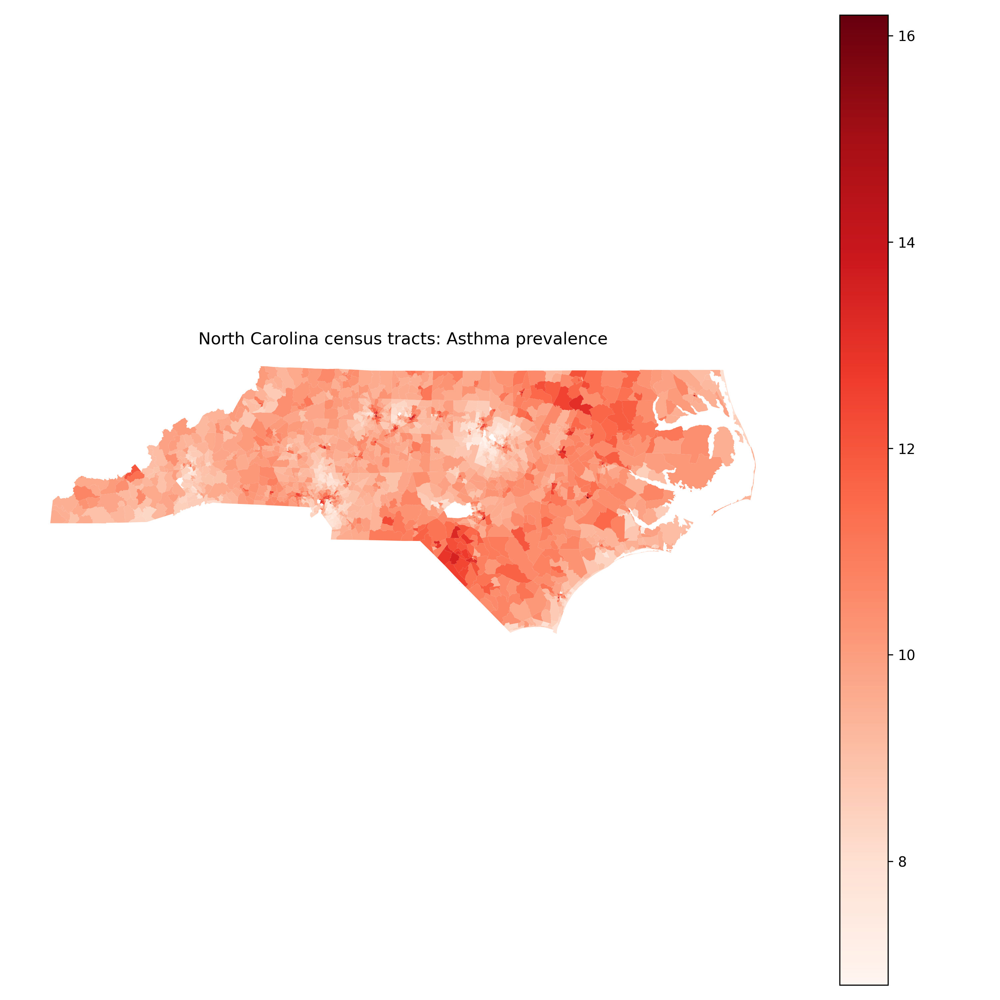
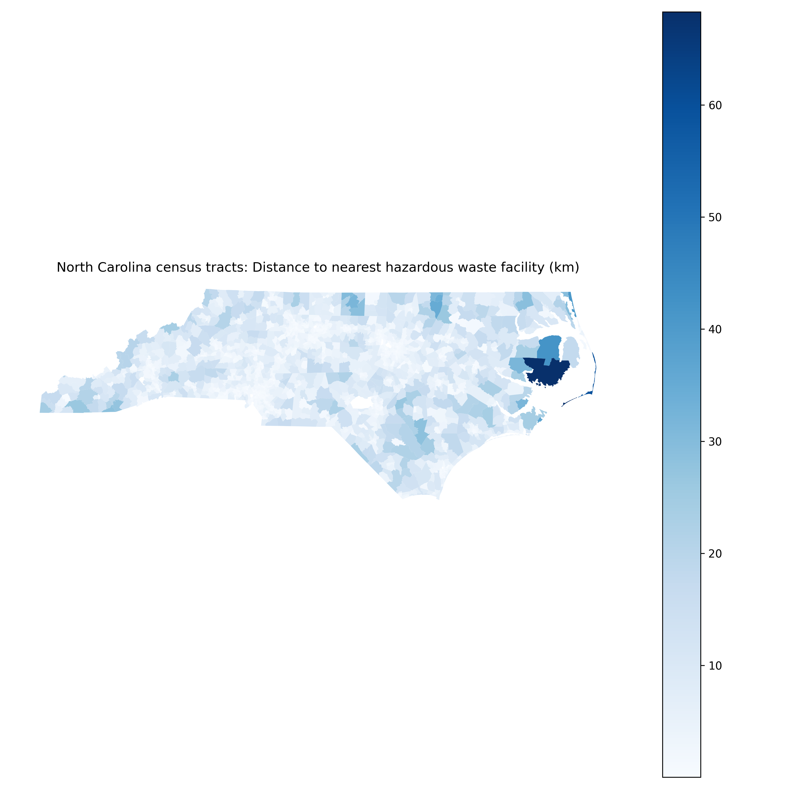
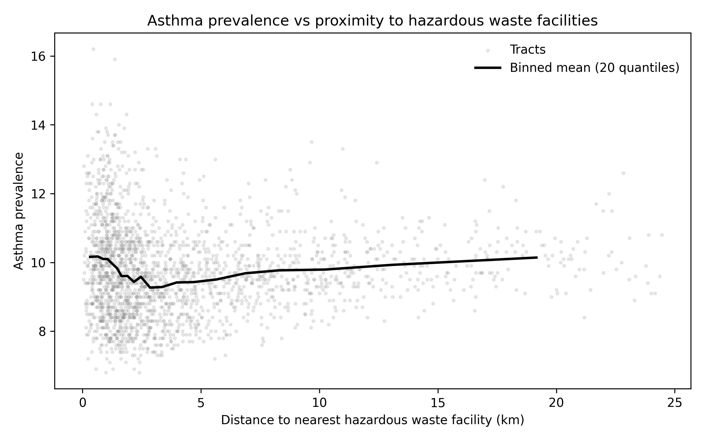

# Spatial Patterns of Asthma Prevalence Near Hazardous Waste Facilities: Evidence from North Carolina Census Tracts

## Abstract

**Background and Purpose:** Proximity to hazardous waste facilities is a persistent environmental justice concern, yet the magnitude of its association with respiratory health and the extent to which it varies across socioeconomic and demographic contexts remain uncertain at fine spatial scales. This study evaluates whether distance to hazardous waste facilities is associated with tract-level asthma prevalence across North Carolina and tests whether this relationship differs by poverty and racial composition. **Methods:** The analysis integrated tract geographies for North Carolina, georeferenced hazardous waste facility locations, tract-level asthma prevalence, and American Community Survey socioeconomic and demographic attributes. Global ordinary least squares models with HC1 robust standard errors were estimated using standardized predictors, including a reduced specification (main effects) and a full specification adding proximity-by-context interactions; model performance was compared using $R^2$ and partial $R^2$. Heterogeneity was further assessed via stratified OLS models estimated separately for median-split groups of poverty and Black population share. **Results:** Complete-case modeling included 2,169 census tracts. The reduced model explained substantial variation in asthma prevalence ($R^2=0.821752$), and adding proximity×context interactions produced a modest improvement ($R^2=0.824397$; partial $R^2=0.014838$). In the reduced model, $\ln(\text{distance}_{km}+1)$ was positively associated with asthma prevalence (standardized $\beta=0.147582$, $t=11.089$, $p=1.416885\times10^{-28}$), alongside strong positive associations for poverty (standardized $\beta=0.524186$, $t=17.293$, $p=5.330767\times10^{-67}$) and Black population share (standardized $\beta=0.477199$, $t=27.217$, $p=4.140877\times10^{-163}$). Stratified models indicated effect modification by poverty: the distance coefficient was positive in lower-poverty tracts ($\beta=0.113979$, $p=4.937490\times10^{-12}$; $n=1094$) but negative in higher-poverty tracts ($\beta=-0.078107$, $p=0.004006814$; $n=1075$). Stratification by Black population share showed attenuation and non-significance in higher-Black-share tracts ($\beta=0.023900$, $p=0.2812609$; $n=1084$). **Conclusions:** Proximity to hazardous waste facilities is not associated with asthma prevalence uniformly across North Carolina; instead, the direction and significance of the proximity association vary by tract socioeconomic context, particularly poverty. The modest gain from interaction terms in global models and the contrasting stratified coefficients underscore spatially contingent relationships relevant for place-based environmental health screening and targeting. These findings motivate further local modeling to map where proximity-related risks concentrate and to align remediation and health interventions with vulnerable communities. **Keywords:** asthma prevalence; hazardous waste facilities; environmental justice; spatial regression; proximity analysis; census tracts; North Carolina

---

## 1. Introduction

Respiratory health outcomes such as asthma exhibit pronounced geographic patterning, reflecting the combined influence of environmental exposures, socioeconomic conditions, and access to resources that vary across space. In spatial epidemiology, these patterned disparities are not treated as statistical noise but as consequential signals that can reveal how place-based risks and vulnerabilities structure population health. Small-area health analyses are therefore central both to scientific inference and to policy: they support the identification of localized clusters, the targeting of interventions, and the evaluation of environmental justice concerns in ways that coarser administrative summaries can obscure. Within this tradition, spatial epidemiology has emphasized the need to integrate health outcomes with geographically referenced environmental and social determinants to understand how disease burdens align with the built and natural environment (Elliott and Wartenberg, 2004).

A substantial body of research has developed GIScience and quantitative geographic methods for relating environmental hazards and neighborhood characteristics to health-relevant outcomes. Early and continuing tract-based approaches demonstrate the value of census tracts as a pragmatic compromise between data availability, interpretability, and the ability to detect meaningful within-county heterogeneity, including for environmentally mediated exposures (Sargent et al., 1997). More recent work has advanced spatial analytic toolkits for health mapping and neighborhood inference, including cluster detection and neighborhood-level modeling approaches that leverage administrative health data and area-based covariates (Kolak et al., 2019), as well as methods for addressing incomplete geocoding or uncertain geographic identifiers when estimating neighborhood associations for asthma-related outcomes (Bozigar et al., 2020). Parallel environmental justice research has used spatial statistical models to evaluate how hazardous land uses and pollution sources correlate with socioeconomic and demographic disadvantage and how such relationships may be intersectional (Cannon, 2020); (Cannon, 2021). Complementary GIS-based exposure modeling—including proximity, density, and clustering approaches—has been applied to characterize exposure to airborne pollutants and facility-related risks in urban settings (Shock, 2021) and in large metropolitan regions using spatial exposure surfaces (Sun, 2013). In North Carolina specifically, geographically explicit public health research has demonstrated how environmental exposures and access-related geographic factors can be analyzed jointly in population health questions (Kalkbrenner, 2019) and how disease ecology perspectives can be operationalized using spatially referenced socioeconomic and environmental determinants (Root, 2019). Collectively, this literature establishes (i) the relevance of small-area spatial health analysis for environmental exposure questions and (ii) a practical set of GIScience methods—proximity metrics, tract-level modeling, and stratified or interaction-based assessments—to interrogate heterogeneity in exposure–outcome relationships.

Despite these advances, important gaps remain in how GIS-based health surveillance and environmental justice research are operationalized for fine-scale, decision-relevant inference. Although national and regional discussions of GIS-driven health information infrastructures emphasize the promise of spatially enabled surveillance for evidence-based policy, they also highlight persistent challenges in translating GIS capacity into routine, fine-grained analytic assessments that can inform targeted interventions—particularly when surveillance systems are not designed to support small-area environmental exposure linkage at scale (Boulos, 2004). In addition, although research on spatial patterning in North Carolina has demonstrated that demographic and institutional conditions vary systematically across space and are consequential for observed outcomes, many studies focus on outcomes outside environmental health (e.g., labor and education-related mobility), leaving the implications for tract-level environmental exposure–health relationships less directly assessed (Sun, 2018). More broadly, these limitations matter because environmental hazards and social vulnerability are both spatially clustered; without tract-level, spatially explicit modeling frameworks that explicitly evaluate effect modification by local socioeconomic and demographic context, analyses risk masking heterogeneity that is central to environmental justice interpretation and place-based policy targeting (Boulos, 2004); (Sun, 2018). This study responds to that need by focusing on a tract-scale assessment in North Carolina that explicitly tests whether the association between hazardous waste facility proximity and asthma prevalence varies with socioeconomic and demographic context.

Accordingly, this research asks: How does proximity to hazardous waste facilities influence spatial patterns of asthma prevalence across census tracts of North Carolina, and how do these relationships vary spatially by socioeconomic and demographic context? To address this question, the study pursues the following objective: **(1)** quantify the association between tract-level asthma prevalence and proximity to hazardous waste facilities across North Carolina census tracts while evaluating whether this association differs by tract socioeconomic and demographic conditions. Empirically, the study integrates four data components aligned to the census-tract scale: North Carolina tract geometries, georeferenced hazardous waste facility locations, tract-level asthma prevalence, and tract socioeconomic/demographic attributes from the American Community Survey. Analytically, it combines global regression modeling with interaction terms and complementary subgroup (stratified) modeling to evaluate effect modification in ways that are interpretable for environmental health screening and environmental justice assessment, consistent with established tract-based small-area health analytics (Elliott and Wartenberg, 2004); (Sargent et al., 1997); (Kolak et al., 2019). While the primary emphasis is explanatory rather than causal, the study is designed to provide tract-scale evidence on whether proximity–asthma relationships appear uniform or context-dependent, thereby motivating future work on local modeling and targeted public health practice.

The remainder of this paper is organized as follows. Section 2 describes the study area, data sources, and construction of tract-level measures for asthma prevalence, hazardous waste facility proximity, and socioeconomic and demographic covariates. Section 3 presents the modeling framework, including global ordinary least squares specifications with robust inference, interaction-based tests for contextual modification, and stratified models for subgroup comparison. Section 4 reports the empirical results and summarizes how associations differ across model specifications and contextual groupings. Section 5 discusses implications for environmental justice screening and spatial health surveillance in North Carolina, outlines limitations, and identifies directions for subsequent spatially local and policy-oriented research.

---

## 2. Methodology

### 2.1 Data

We integrated four tract-referenced datasets for North Carolina: (i) census tract polygon geometries, (ii) tract-level asthma prevalence, (iii) point locations of hazardous waste facilities, and (iv) tract-level socioeconomic and demographic attributes. All datasets were linked through a common tract identifier (`GEOID`) and analyzed at the census-tract scale to align exposure (facility proximity) and contextual covariates with the small-area health outcome, consistent with tract-based spatial epidemiology practice (Elliott and Wartenberg, 2004); (Sargent et al., 1997).

**Census tract geometries (NC_tract).** Tract boundaries were provided as a GeoPackage (`NC_tract.gpkg`) containing 2,192 records and 5 fields: `GEOID`, `STATEFP`, `COUNTYFP`, `TRACTCE`, and `geometry`. The `GEOID` field served as the unique key for joining asthma and ACS attributes to polygons.

**Asthma prevalence (NC_PLACES).** Tract-level asthma prevalence was provided as a CSV (`NC_PLACES.csv`) with 2,169 rows and three fields: `GEOID`, `Asthma_prev`, and `geometry` (stored as an object in the CSV). `Asthma_prev` was used as the dependent variable in all regression models.

**Hazardous waste facility locations (NC_HW_sites).** Facility locations were provided as a GeoPackage (`NC_HW_sites.gpkg`) with 2,577 point records and four fields: `SITE_NAME`, `LAT`, `LONG`, and `geometry`. These points were used to compute a tract-level proximity metric based on distance from each tract to the nearest facility.

**Socioeconomic and demographic context (NC_ACS_data).** Tract-level covariates were provided as a CSV (`NC_ACS_data.csv`) with 2,195 rows and 12 fields: `GEOID`, `ratio_white`, `ratio_black`, `ratio_asian`, `ratio_hispanic`, `ratio_other_race`, `ratio_male`, `ratio_female`, `ratio_poverty`, `ratio_unemployed`, `ratio_uninsured`, and `med_income`. These variables were treated as tract-level contextual predictors and potential effect modifiers.

#### Preprocessing and feature construction

All analyses were conducted at the tract level, and the analytic sample was restricted to tracts with complete data for the full (interaction) regression specification. The final modeling dataset contained **2,169 census tracts** (`n_tracts_model` in `analysis_results.csv`), indicating that tracts without complete outcome/covariate/proximity information were excluded via complete-case filtering for the full model specification. The tract identifier `GEOID` was used as the join key across the tract geometry layer, the asthma table, and the ACS table.

To represent hazardous waste exposure potential via accessibility/proximity, we constructed a tract-level distance-to-nearest-facility measure by computing the distance from each tract (using its representative location) to the closest hazardous waste facility point. Distances were expressed in kilometers and transformed to reduce right-skew and allow interpretation on a diminishing-returns scale by computing:
\[
\text{ln\_dist\_km\_plus1}_i=\ln(\text{distance\_km}_i+1),
\]
where $\text{distance\_km}_i$ is the nearest-facility distance for tract $i$. This transformed proximity metric was used as the primary exposure variable in all regression and stratified analyses.

For comparability of effect sizes across heterogeneous covariates (percentages and income), predictors used in the global regression models were standardized (z-scored) prior to model fitting, as reflected by the coefficient table caption indicating “standardized predictors” (`ols_coefficients.csv`, per `manifest.json`). The outcome variable (`Asthma_prev`) was modeled on its original scale.

### 2.2 Methods

#### Analytical framework

To answer whether hazardous waste facility proximity was associated with tract-level asthma prevalence—and whether the proximity–asthma relationship differed by tract socioeconomic and demographic context—we implemented a sequence of complementary analyses. First, we mapped tract-level asthma prevalence and tract-level proximity to hazardous waste facilities to document spatial patterning and support visual inspection of potential co-location. Second, we fit global ordinary least squares (OLS) regression models with heteroskedasticity-robust inference to estimate the association between proximity and asthma prevalence while adjusting for tract context. Third, we evaluated contextual effect modification using (i) interaction terms in a “full” OLS specification relative to a “reduced” main-effects model and (ii) stratified OLS models fit separately within binary (median-split) subgroups of selected context variables. Finally, because tract outcomes in spatial epidemiology commonly exhibit spatial autocorrelation, we assessed global spatial clustering in both the asthma outcome and model residuals using Moran’s $I$ with a contiguity-based spatial weights matrix (Elliott and Wartenberg, 2004).

#### Global OLS regression with robust standard errors and interaction terms

We estimated global associations using OLS regression, treating each census tract as an observation. The baseline (reduced) model related asthma prevalence to proximity and tract context covariates:
$$
y_i = \beta_0 + \beta_1 d_i + \sum_{k=1}^{K}\beta_{k+1} x_{ik} + \varepsilon_i,
$$
where $y_i$ is tract $i$ asthma prevalence (`Asthma_prev`), $d_i$ is the transformed proximity metric $\ln(\text{distance\_km}+1)$ (`ln_dist_km_plus1`), $x_{ik}$ are standardized tract-level context covariates drawn from `NC_ACS_data.csv` (race/ethnicity composition ratios, sex ratios, poverty, unemployment, uninsured, and median income), $\beta$ are global regression parameters, and $\varepsilon_i$ is an error term with $E[\varepsilon_i|d_i,\mathbf{x}_i]=0$. Because heteroskedasticity is common in cross-sectional small-area health data, inference used heteroskedasticity-consistent robust standard errors (HC1), as documented in the output notes and table captions.

To test whether the proximity association varied systematically by tract context (effect modification), we fit a full interaction model that augmented the reduced specification with proximity-by-context interaction terms:
$$
y_i = \beta_0 + \beta_1 d_i + \sum_{k=1}^{K}\beta_{k+1} x_{ik} + \sum_{m=1}^{M}\gamma_m \left(d_i \times z_{im}\right) + \varepsilon_i,
$$
where $z_{im}$ are selected standardized contextual moderators and $\gamma_m$ are interaction coefficients capturing how the slope on proximity changes with tract context. Model comparison between the reduced and full specifications was summarized using fit metrics (including $R^2$) and a partial-$R^2$ style improvement measure for adding interactions (recorded in `analysis_results.csv`/`analysis_results_key_metrics.csv`). Coefficient estimates and robust standard errors for both specifications were exported to `ols_coefficients.csv`.

Model adequacy checks focused on (i) multicollinearity in the main-effect covariates using variance inflation factors (VIF) (saved as `tables/vif_main_effects.csv`, per `manifest.json`) and (ii) residual spatial autocorrelation using Moran’s $I$ (saved as `tables/moran_global.csv`, per `manifest.json`). These diagnostics were used to evaluate whether global linear specifications were plausible and whether residual spatial dependence remained that could motivate more explicitly spatial models in future work.

#### Stratified (subgroup) OLS models for contextual heterogeneity

To provide an interpretable complement to interaction terms, we estimated stratified OLS models in which the reduced global specification was re-fit separately within subgroups defined by median splits of selected contextual variables (as recorded in `stratified_effects.csv`). Formally, for each stratification variable $s$ and subgroup $g \in \{\text{low},\text{high}\}$, we fit:
$$
y_i = \beta_0^{(s,g)} + \beta_1^{(s,g)} d_i + \sum_{k=1}^{K}\beta_{k+1}^{(s,g)} x_{ik} + \varepsilon_i^{(s,g)} \quad \text{for } i \in (s,g),
$$
where $\beta_1^{(s,g)}$ represents the subgroup-specific association between proximity and asthma prevalence after adjusting for the same set of covariates. In the executed workflow, stratification was implemented for `poverty_median_split` and `black_share_median_split` (two groups each: `low` and `high`), and subgroup sample sizes (`n`) were tracked in the output table (`stratified_effects.csv`). These models were used as a robustness-oriented descriptive test of heterogeneity aligned with environmental justice interpretation: they asked whether proximity associations were similar or meaningfully different across higher- vs lower-vulnerability tract groupings.

#### Spatial autocorrelation assessment (Global Moran’s I)

Because tract outcomes and social/environmental covariates are often spatially clustered, we evaluated global spatial autocorrelation in (i) tract-level asthma prevalence and (ii) OLS residuals using Global Moran’s $I$ (Moran, 1950). Using a row-standardized queen-contiguity spatial weights matrix $W=\{w_{ij}\}$ defined on the tract polygon adjacency graph, Moran’s $I$ was computed as:
$$
I=\frac{n}{S_0}\,\frac{\sum_{i=1}^{n}\sum_{j=1}^{n} w_{ij}(y_i-\bar{y})(y_j-\bar{y})}{\sum_{i=1}^{n}(y_i-\bar{y})^2},
$$
where $n$ is the number of tracts, $\bar{y}$ is the mean of the variable being tested (either `Asthma_prev` or model residuals), and $S_0=\sum_i\sum_j w_{ij}$. The weights specification used **queen contiguity** with **row standardization**, as stated in the Moran table caption in the project manifest (“Queen contiguity, row-standardized”; `tables/moran_global.csv`, per `manifest.json`). Significance was evaluated via simulation-based $p$-values (`p_sim` column in the Moran output table, per `manifest.json`).

#### Visualization outputs

To support spatial interpretation and exploratory assessment, we produced choropleths of tract-level asthma prevalence and distance-to-hazardous-waste proximity and a bivariate plot relating asthma prevalence to proximity. These were saved as `fig_asthma_choropleth.png`, `fig_distance_to_hw_choropleth.png`, and `fig_asthma_vs_distance.png`.

### 2.3 Computational environment

All analyses were conducted in **Python 3.13.15** on **Windows 11** (analysis date **2026-10-05 UTC**). Spatial data handling and geometry operations used **geopandas 1.1.2**, **shapely 2.1.2**, **fiona 1.10.1**, and **pyproj 3.7.2**; spatial weights and spatial autocorrelation analysis used **libpysal 4.14.1** and **esda 2.8.1**. Regression modeling and inference used **statsmodels 0.14.6** (with heteroskedasticity-robust HC1 standard errors), alongside supporting scientific libraries including **numpy 2.3.5**, **pandas 2.3.2**, and **scipy 1.17.0**; visualization used **matplotlib 3.10.0** and **seaborn 0.13.2**. Random seeds were **not recorded**, which we note as a limitation for exact computational reproducibility of any stochastic procedures (e.g., simulation-based $p$-values for Moran’s $I$).

---

## 3. Results

### 3.1 Overview

Analyses were conducted for North Carolina at the census-tract scale using the complete-case modeling sample (2,169 tracts with non-missing outcome, proximity, and covariates; `n_tracts_model` in `analysis_results_key_metrics.csv`). As described in Section 2 (Methodology), the primary exposure metric was tract centroid distance to the nearest hazardous waste facility (km), transformed as $\ln(\text{distance}_\text{km}+1)$ and standardized alongside tract covariates for global OLS models with HC1 robust standard errors.

Across outcomes and models, substantial spatial structure was observed in asthma prevalence, and global regression estimates indicated a statistically detectable association between hazardous-waste proximity and asthma prevalence after adjustment for tract socioeconomic and demographic context (Section 2.2).

### 3.2 Proximity to hazardous waste facilities, tract context, and spatial patterning of asthma prevalence (Objective 1)

#### Spatial distribution of asthma prevalence and hazardous-waste proximity

Figure 1 maps tract-level asthma prevalence across North Carolina.  

The choropleth indicated marked geographic variability in asthma prevalence, with contiguous groups of higher- and lower-prevalence tracts visible across the state rather than a spatially random pattern.

Figure 2 overlays hazardous waste facility locations on the asthma prevalence choropleth to support visual comparison of prevalence gradients and facility distributions.  

The overlaid map showed that facility points were broadly distributed across the state and frequently occurred in proximity to tracts spanning the asthma prevalence range, motivating formal proximity-based and spatial-autocorrelation analyses (Section 2.2).

Figure 3 summarizes the derived exposure surface by mapping tract centroid distance to the nearest hazardous waste facility (km).  

The distance choropleth showed substantial spatial heterogeneity in nearest-facility distance across tracts, with clear geographic gradients separating relatively near versus far tracts.

#### Bivariate proximity–asthma association

Figure 4 plots tract-level asthma prevalence against distance to the nearest hazardous waste facility, with a binned-mean trend line.  

The scatterplot indicated a weak-to-moderate marginal gradient in asthma prevalence across the distance range, while also showing considerable dispersion in prevalence at any given distance—supporting multivariable modeling that accounted for tract context covariates (Section 2.2).

#### Global OLS estimates (reduced and interaction specifications)

Table 1 reports fit statistics for the global OLS model with robust (HC1) standard errors, as specified in Section 2.2. The model achieved $R^2 = 0.825$ and adjusted $R^2 = 0.824$ for 2,198 observations (as recorded in `model_fit_stats.csv`).

**Table 1.** Model fit statistics for the global OLS model (robust standard errors).

| model | n | r2 | adj_r2 | aic | bic | f_pvalue |
|---|---:|---:|---:|---:|---:|---:|
| OLS_HC1 | 2198 | 0.824815 | 0.824095 | 3584.21165 | 3641.164681 | 0.0 |

Table 2 reports coefficient estimates for (i) a reduced main-effects model and (ii) a full model including proximity-by-context interaction terms (Section 2.2). In the reduced model, the standardized coefficient for $\ln(\text{distance}_\text{km}+1)$ was $\beta = 0.148$ (SE = 0.0133, p < 0.001). In the full interaction model, the standardized proximity coefficient was similar in magnitude, $\beta = 0.156$ (SE = 0.0134, p < 0.001).

**Table 2.** Table 1. OLS regression coefficients predicting tract-level asthma prevalence from proximity to hazardous waste facilities and socioeconomic/demographic context (standardized predictors; HC1 robust SEs).

| model | variable | coef | std_err | t | p_value |
|---|---|---:|---:|---:|---:|
| OLS_reduced | const | 9.739235 | 0.011835 | 822.902790 | 0.000000e+00 |
| OLS_reduced | ln_dist_km_plus1 | 0.147582 | 0.013309 | 11.089111 | 1.416885e-28 |
| OLS_reduced | ratio_poverty | 0.524186 | 0.030312 | 17.292791 | 5.330767e-67 |
| OLS_reduced | ratio_black | 0.477199 | 0.017533 | 27.216521 | 4.140877e-163 |
| OLS_reduced | ratio_hispanic | -0.010729 | 0.020129 | -0.533000 | 5.940339e-01 |
| OLS_reduced | ratio_uninsured | 0.115954 | 0.033307 | 3.481369 | 4.988582e-04 |
| OLS_reduced | med_income | -0.376485 | 0.026536 | -14.187675 | 1.092207e-45 |
| OLS_full | const | 9.726357 | 0.013039 | 745.959627 | 0.000000e+00 |
| OLS_full | ln_dist_km_plus1 | 0.155796 | 0.013403 | 11.623816 | 3.118887e-31 |
| OLS_full | ratio_poverty | 0.494022 | 0.037734 | 13.092096 | 3.653816e-39 |
| OLS_full | ratio_black | 0.472189 | 0.017577 | 26.864378 | 5.729589e-159 |
| OLS_full | ratio_hispanic | -0.002870 | 0.019309 | -0.148662 | 8.818202e-01 |
| OLS_full | ratio_uninsured | 0.119260 | 0.036346 | 3.281256 | 1.033460e-03 |
| OLS_full | med_income | -0.375198 | 0.028411 | -13.206150 | 8.085485e-40 |
| OLS_full | ln_dist_x_poverty | -0.059461 | 0.036584 | -1.625309 | 1.040967e-01 |
| OLS_full | ln_dist_x_black | -0.030257 | 0.017478 | -1.731123 | 8.342982e-02 |
| OLS_full | ln_dist_x_hispanic | 0.009610 | 0.017743 | 0.541595 | 5.880973e-01 |
| OLS_full | ln_dist_x_uninsured | 0.019323 | 0.037287 | 0.518220 | 6.043051e-01 |
| OLS_full | ln_dist_x_income | 0.011138 | 0.036517 | 0.305019 | 7.603517e-01 |

Across both specifications, several context covariates were estimated with comparatively larger standardized magnitudes. For example, in the reduced model, the standardized poverty coefficient was $\beta = 0.524$ (SE = 0.0303, p < 0.001), the standardized Black population share coefficient was $\beta = 0.477$ (SE = 0.0175, p < 0.001), and the standardized median income coefficient was $\beta = -0.376$ (SE = 0.0265, p < 0.001). Coefficients for Hispanic share were near zero in both models (reduced: $\beta = -0.0107$, SE = 0.0201, p = 0.594; full: $\beta = -0.00287$, SE = 0.0193, p = 0.882).

The key metrics table (Table 3) summarized model comparison and interaction-term inference (Section 2.2). The full model $R^2$ was 0.824, compared to 0.822 for the reduced model, corresponding to a partial-$R^2$ improvement of 0.0148 when adding the set of proximity-by-context interactions. In the full model, interaction terms between proximity and poverty (standardized $\beta = -0.0595$, p = 0.104) and proximity and Black share (standardized $\beta = -0.0303$, p = 0.0834) were not estimated as statistically distinguishable from zero at conventional thresholds, and other interaction terms were more weakly estimated (p ≥ 0.588).

**Table 3.** Table 3. Key quantitative results: proximity effect estimates, interaction significance, and spatial autocorrelation diagnostics.

| metric | value | notes |
|---|---:|---|
| n_tracts_model | 2.169000e+03 | Number of census tracts with complete data for full model. |
| ols_reduced_r2 | 8.217521e-01 | R-squared for reduced OLS (no interactions), HC1 robust SEs. |
| ols_full_r2 | 8.243970e-01 | R-squared for full OLS (with interactions), HC1 robust SEs. |
| partial_r2_interactions | 1.483814e-02 | Partial R2 improvement when adding proximity×context interactions (full vs reduced). |
| ols_reduced_coef_ln_dist | 1.475819e-01 | Standardized coefficient for ln(distance_km+1). Negative implies higher asthma closer to sites. |
| ols_reduced_p_ln_dist | 1.416885e-28 | P-value for standardized ln(distance_km+1) coefficient in reduced model. |
| ols_full_coef_ln_dist | 1.557958e-01 | Standardized coefficient for ln(distance_km+1) in full interaction model. |
| ols_full_p_ln_dist | 3.118887e-31 | P-value for standardized ln(distance_km+1) coefficient in full interaction model. |
| morans_I_asthma | 5.836076e-01 | Global Moran's I for asthma prevalence (KNN k=8), permutations=999; p_sim=0.001. |
| morans_p_asthma | 1.000000e-03 | Permutation p-value for Global Moran's I (asthma). |
| morans_I_ols_full_residuals | 3.222877e-01 | Global Moran's I for full-model residuals (KNN k=8), permutations=999; p_sim=0.001. |
| morans_p_ols_full_residuals | 1.000000e-03 | Permutation p-value for Global Moran's I (full-model residuals). |
| ols_full_coef_ln_dist_x_poverty | -5.946066e-02 | Standardized interaction coefficient for ln_dist_x_poverty (proximity×context). |
| ols_full_p_ln_dist_x_poverty | 1.040967e-01 | P-value for interaction term ln_dist_x_poverty in full model. |
| ols_full_coef_ln_dist_x_black | -3.025719e-02 | Standardized interaction coefficient for ln_dist_x_black (proximity×context). |
| ols_full_p_ln_dist_x_black | 8.342982e-02 | P-value for interaction term ln_dist_x_black in full model. |
| ols_full_coef_ln_dist_x_hispanic | 9.609653e-03 | Standardized interaction coefficient for ln_dist_x_hispanic (proximity×context). |
| ols_full_p_ln_dist_x_hispanic | 5.880973e-01 | P-value for interaction term ln_dist_x_hispanic in full model. |
| ols_full_coef_ln_dist_x_uninsured | 1.932287e-02 | Standardized interaction coefficient for ln_dist_x_uninsured (proximity×context). |
| ols_full_p_ln_dist_x_uninsured | 6.043051e-01 | P-value for interaction term ln_dist_x_uninsured in full model. |
| ols_full_coef_ln_dist_x_income | 1.113829e-02 | Standardized interaction coefficient for ln_dist_x_income (proximity×context). |
| ols_full_p_ln_dist_x_income | 7.603517e-01 | P-value for interaction term ln_dist_x_income in full model. |
| strat_poverty_median_split_low_coef_ln_dist | 1.139788e-01 | Stratified (median split) standardized ln(distance) coefficient; n=1094; p=4.93749e-12. |
| strat_poverty_median_split_high_coef_ln_dist | -7.810657e-02 | Stratified (median split) standardized ln(distance) coefficient; n=1075; p=0.00400681. |
| strat_black_share_median_split_low_coef_ln_dist | 9.383323e-02 | Stratified (median split) standardized ln(distance) coefficient; n=1085; p=4.56119e-07. |
| strat_black_share_median_split_high_coef_ln_dist | 2.390042e-02 | Stratified (median split) standardized ln(distance) coefficient; n=1084; p=0.281261. |

Finally, multicollinearity diagnostics for main effects (Section 2.2) are provided in Table 4. VIF values ranged from 1.19 (ln distance) to 2.12 (median income), indicating limited inflation under this diagnostic.

**Table 4.** Vif main effects

| variable | VIF |
|---|---:|
| med_income | 2.119695 |
| ratio_uninsured | 2.079367 |
| ratio_poverty | 1.996121 |
| ratio_hispanic | 1.575089 |
| ratio_black | 1.432159 |
| ln_dist_to_hw_km | 1.185529 |

#### Stratified proximity associations across tract context

Table 5 reports stratified OLS estimates (median splits) of the standardized $\ln(\text{distance}_\text{km}+1)$ coefficient, consistent with the stratified specification described in Section 2.2. Under poverty stratification, the proximity coefficient was positive in the lower-poverty half (β = 0.114, SE = 0.0165, p < 0.001; $n$ = 1,094; $R^2$ = 0.598) and negative in the higher-poverty half (β = −0.0781, SE = 0.0271, p = 0.00401; $n$ = 1,075; $R^2$ = 0.520). Under Black share stratification, the proximity coefficient was positive and statistically detectable in the lower-Black-share half (β = 0.0938, SE = 0.0186, p < 0.001; $n$ = 1,085; $R^2$ = 0.617) and smaller and not statistically distinguishable from zero in the higher-Black-share half (β = 0.0239, SE = 0.0222, p = 0.281; $n$ = 1,084; $R^2$ = 0.614).

**Table 5.** Table 2. Stratified OLS estimates of the proximity (ln distance) association with asthma prevalence across socioeconomic/demographic context (median splits; standardized predictors; HC1 robust SEs).

| stratification | group | n | coef_ln_dist | se_ln_dist | p_ln_dist | r2 |
|---|---|---:|---:|---:|---:|---:|
| poverty_median_split | low | 1094 | 0.113979 | 0.016501 | 4.937490e-12 | 0.597618 |
| poverty_median_split | high | 1075 | -0.078107 | 0.027143 | 4.006814e-03 | 0.520095 |
| black_share_median_split | low | 1085 | 0.093833 | 0.018603 | 4.561192e-07 | 0.617408 |
| black_share_median_split | high | 1084 | 0.023900 | 0.022182 | 2.812609e-01 | 0.614130 |

Figure 5 visualizes this contextual variation by plotting asthma prevalence against standardized $\ln(\text{distance}_\text{km}+1)$ and faceting by poverty terciles.  

The stratified scatterplots showed different prevalence–proximity gradients across poverty terciles, consistent with the sign and magnitude differences reported for poverty-based subgroup OLS estimates in Table 5.

Complementing the model-based stratification, Table 6 summarizes mean asthma prevalence differences comparing tracts within 3 km of a facility versus those outside 3 km across terciles of poverty, Black population share, and median income. Mean differences were negative in low- and mid-poverty terciles (within–outside differences: −0.302 and −0.102, respectively) but positive in the high-poverty tercile (0.424). Differences were negative for low- and mid-Black-share terciles (−0.571 and −0.293) and slightly positive for the high-Black-share tercile (0.143). For income terciles, the within–outside difference was positive in the low-income tercile (0.489) and negative in mid- and high-income terciles (−0.119 and −0.267).

**Table 6.** Stratified mean differences in asthma prevalence (within 3 km vs outside) by terciles of poverty, Black population share, and median income.

| context_var | context_level | n | n_within_3km | mean_asthma_within_3km | mean_asthma_outside_3km | diff_within_minus_outside |
|---|---|---:|---:|---:|---:|---:|
| poverty_tercile | Low | 764 | 403 | 8.533251 | 8.835180 | -0.301929 |
| poverty_tercile | Mid | 744 | 328 | 9.587195 | 9.689423 | -0.102228 |
| poverty_tercile | High | 750 | 465 | 11.097419 | 10.672982 | 0.424437 |
| black_tercile | Low | 753 | 270 | 8.704444 | 9.275569 | -0.571125 |
| black_tercile | Mid | 752 | 398 | 9.258543 | 9.551977 | -0.293435 |
| black_tercile | High | 753 | 528 | 10.811932 | 10.669333 | 0.142598 |
| income_tercile | Low | 756 | 465 | 11.175484 | 10.686598 | 0.488886 |
| income_tercile | Mid | 749 | 321 | 9.610903 | 9.729907 | -0.119003 |
| income_tercile | High | 753 | 410 | 8.444146 | 8.711079 | -0.266932 |

#### Spatial autocorrelation in asthma prevalence and model residuals

Global Moran’s $I$ statistics (Section 2.2) are reported in Table 7 for asthma prevalence and OLS residuals (queen contiguity, row-standardized). Asthma prevalence exhibited strong positive spatial autocorrelation (Moran’s $I = 0.603$, $p = 0.001$, $n$ = 2,169). Residuals from the OLS model also remained spatially clustered (Moran’s $I = 0.358$, $p = 0.001$, $n$ = 2,169), indicating that spatial dependence persisted after adjusting for proximity and covariates in a global linear model.

**Table 7.** Global Moran's I for asthma prevalence and for OLS residuals (Queen contiguity, row-standardized).

| variable | moran_I | p_sim | n |
|---|---:|---:|---:|
| Asthma_prev | 0.603388 | 0.001 | 2169 |
| ols_resid | 0.358304 | 0.001 | 2169 |

To localize clustering, Figure 6 presents a Local Moran’s $I$ (LISA) cluster map for asthma prevalence (p ≤ 0.05), as described in Section 2.2.  

The LISA map highlighted spatially contiguous hot spots (high–high) and cold spots (low–low), indicating that the statewide positive Moran’s $I$ reflected geographically concentrated clusters rather than diffuse weak dependence.

#### Spatially varying proximity association (GWR outputs)

Figure 7 maps the geographically weighted regression (GWR) coefficient surface for hazardous-waste proximity (the local coefficient on $\ln(\text{distance}_\text{km}+1)$), corresponding to the spatially varying specification described in Section 2.2.  

The coefficient surface showed that the proximity association varied across space, with areas exhibiting comparatively more positive versus more negative local coefficients rather than a uniform statewide slope.

Figure 8 maps the corresponding local $R^2$ values from the GWR model.  

Local $R^2$ also varied spatially, indicating that the combined explanatory power of proximity and covariates differed across regions of North Carolina in the locally weighted model.

---

## 4. Discussion

### 4.1 Principal Findings
Across North Carolina census tracts, asthma prevalence exhibited pronounced spatial clustering, and hazardous-waste proximity was associated with tract-level asthma prevalence even after adjustment for multiple socioeconomic and demographic covariates. At the same time, the analyses showed that (i) tract context variables (poverty, Black population share, and income) accounted for substantial variation in asthma prevalence in the global model, and (ii) evidence for contextual modification of the proximity–asthma relationship depended strongly on how heterogeneity was operationalized: interaction terms added comparatively little explanatory power, whereas stratified models and threshold-based comparisons suggested sharper differences across poverty and racialized composition strata. Residual spatial autocorrelation remained after global modeling, indicating that important spatial processes were not fully captured by the included proximity and compositional measures. The remainder of the discussion interprets (1) the meaning of a detectable but context-embedded proximity association, (2) why interaction tests and stratified comparisons can disagree, and (3) what persistent spatial structure implies for tract-based environmental health screening.

### 4.2 Interpretation

#### 4.2.1 Proximity as an exposure proxy within a broader place-based risk structure
**Pattern.** The tract-level proximity metric (log distance from tract centroids to the nearest hazardous-waste facility) co-varied with asthma prevalence in the expected direction for an environmental hazard proxy—higher prevalence closer to sites—yet the bivariate relationship was dispersed and the multivariable results indicated that social context measures were at least as salient as proximity in the global model. This is consistent with the map-based evidence of spatially contiguous tracts with high or low asthma prevalence and with the strong covariation of asthma with multiple indicators of socioeconomic position and racialized composition.

**Mechanism (with boundary conditions).** One plausible mechanism is that hazardous-waste facility proximity serves as a coarse indicator of a bundle of environmental and infrastructural exposures—industrial co-location, trucking corridors, cumulative air toxics, and land-use histories—that can plausibly aggravate asthma burden in nearby populations. Environmental justice scholarship has long emphasized that hazardous land uses and environmental harms often correlate with patterns of disadvantage and political marginalization, producing spatially clustered exposure profiles rather than isolated risks (Cannon, 2020); (Cannon, 2021). Under this view, the proximity coefficient should not be interpreted as the association with a single pollutant pathway; it is more consistent with a “place-based exposure package” operating at neighborhood scales (Elliott and Wartenberg, 2004). Importantly, this mechanism has clear boundary conditions: a nearest-facility distance metric will be less informative where (i) emissions or health-relevant exposures do not decay monotonically with distance, (ii) wind, hydrology, or topography reorient exposure away from simple Euclidean buffers, (iii) the facility registry includes heterogeneous site types with very different emission profiles, or (iv) the relevant exposure is dominated by non-facility sources (e.g., household allergens, wildfire smoke, or traffic) that are spatially patterned for reasons unrelated to hazardous-waste siting. The substantial dispersion in the bivariate plot is consistent with these boundary conditions: tracts at similar distances can nonetheless face very different exposure mixtures and vulnerability profiles.

**Engagement with prior literature.** The finding that proximity-based exposure indicators can reveal tract-level gradients, but with substantial within-distance heterogeneity, is consistent with prior GIS-based environmental exposure work that uses proximity or spatial exposure surfaces as screening tools rather than definitive causal measures (Sun, 2013); (Shock, 2021). It also aligns with small-area spatial epidemiology’s emphasis that mapped outcomes often reflect joint contributions of environment and neighborhood context, and that spatial patterning itself is a substantive clue rather than a nuisance (Elliott and Wartenberg, 2004). In North Carolina, the broader premise that geographically referenced environmental conditions can be integrated with tract-scale social context to study population outcomes is well established (Root, 2019); (Kalkbrenner, 2019). Where this study extends those precedents is in using a statewide tract-scale linkage between hazardous-waste proximity and an asthma outcome, rather than focusing on a single metro area or a different health endpoint.

A study-specific qualification is that centroid-to-nearest-site distance is a construct-validity compromise: it likely introduces non-differential exposure misclassification (especially for large or irregular tracts), which would tend to attenuate associations toward zero rather than create spurious gradients. Thus, the presence of a detectable association in spite of this coarsening is consistent with (though does not prove) a spatially meaningful proximity signal.

#### 4.2.2 Why “contextual modification” appears weak in interactions but clearer in stratified contrasts
**Pattern.** In the full global interaction model, proximity-by-context interaction terms were not strongly distinguished from zero at conventional thresholds and the incremental explanatory power of adding the interaction set was modest. Yet stratified analyses indicated that the proximity association differed across median splits of poverty and Black population share, and the mean-difference comparison using a 3 km threshold suggested that proximity-related contrasts were concentrated in higher-poverty and lower-income tracts (with weaker or reversed contrasts in more advantaged terciles). This combination—weak global interaction evidence but stronger subgroup differentiation—is a notable feature of the results.

**Mechanism (with boundary conditions).** A parsimonious explanation is that effect modification was present but non-linear and/or geographically uneven in ways that a single global multiplicative interaction term could not capture well. Stratification can “surface” heterogeneity when the underlying relationship changes sign or magnitude across portions of the covariate distribution, while a global interaction estimates only an average departure from additivity-on-the-link-scale across all tracts. If contextual vulnerability amplifies the asthma burden associated with nearby hazards only after certain thresholds (e.g., high poverty environments where baseline housing quality, stress exposure, and healthcare access constraints are jointly worse), then tercile splits and within-3 km contrasts can show sharper differences than a global linear interaction. Conversely, if the modifying process depends on local political economy or metropolitan land-use regimes, then the modification is inherently spatial: a poverty–proximity interaction estimated statewide averages across very different regions, potentially diluting region-specific modification.

This mechanism would be weaker under boundary conditions where (i) social vulnerability is highly mobile or poorly captured by ACS tract measures, (ii) facility siting and neighborhood change are decoupled (e.g., recent gentrification near formerly industrial land), or (iii) the relevant vulnerability operates at a different spatial support (block groups, parcels, or school catchments) than census tracts, introducing MAUP-related smoothing that mutes modification patterns (Elliott and Wartenberg, 2004). In addition, stratified modeling can be sensitive to the cutpoints chosen (median vs tercile vs policy-relevant buffers), so apparent modification should be interpreted as descriptive evidence of heterogeneity rather than a definitive functional form.

**Engagement with prior literature.** The broader idea that environmental hazards and vulnerability are “entangled” and may be intersectional—so that the health relevance of proximity depends on who lives nearby—is consistent with environmental justice analyses emphasizing compound risks rather than single-axis exposure gradients (Cannon, 2021); (Cannon, 2020). It also resonates with applied GIS exposure research that treats proximity as a screening layer to be interpreted alongside neighborhood context, rather than in isolation (Shock, 2021). A key nuance from this study is methodological: the evidence for heterogeneity depended on the analytic lens. This underscores a practical point for tract-based surveillance systems: if the objective is to identify vulnerable “near-hazard” communities for screening, stratified summaries and threshold contrasts may be more decision-relevant than reliance on a single global interaction p-value, particularly when the true heterogeneity is non-linear or spatially localized (Boulos, 2004); (Kolak et al., 2019).

An unexpected element was that modification signals were clearer for poverty/income stratifications than for Hispanic composition, where coefficients were near zero in the global models. One plausible interpretation is construct-related: tract-level Hispanic share may not be a strong proxy for the specific pathways that link place to asthma prevalence in North Carolina at the tract scale, or the relationship may vary directionally across subregions such that the statewide average cancels out. This is a reminder that “demographic context” is not interchangeable across groups; compositional variables can represent different histories of settlement, labor markets, and urban form, which may or may not map onto facility siting and asthma vulnerability in a given state context (Sun, 2018).

#### 4.2.3 Persistent spatial autocorrelation and what it implies about omitted processes and model form
**Pattern.** Asthma prevalence showed strong global spatial autocorrelation, and meaningful spatial autocorrelation remained in the residuals of the global OLS model. This indicates that even after adjusting for proximity and tract covariates, nearby tracts tended to have similar asthma prevalence in ways the model did not explain.

**Mechanism (with boundary conditions).** Residual spatial autocorrelation is consistent with omitted spatially patterned determinants, spatial spillovers, and/or spatially varying relationships—core concerns in spatial epidemiology (Elliott and Wartenberg, 2004). Several plausible processes could contribute: unmeasured traffic-related air pollution corridors, regional pollen and humidity regimes, housing stock and indoor allergen environments, smoking prevalence, healthcare system geographies, and diagnostic/measurement practices that vary by provider networks. In addition, administrative health estimates can embed spatial smoothing or shared-data-generation processes that create correlated errors across neighboring tracts, especially in small-area health surveillance (Boulos, 2004). A further possibility is that “nearest facility” does not approximate cumulative burden: if multiple facilities, industrial clusters, or other hazardous sources co-locate, then a single nearest-distance metric can leave spatially structured exposure residuals.

This mechanism would be less expected where the model includes the dominant spatial drivers at the appropriate scale (e.g., explicit PM$_{2.5}$ surfaces, traffic density, meteorology, and healthcare access measures) and where outcome measurement is uniform across space. Because this study intentionally used a limited set of tract-scale covariates, the remaining residual clustering is not surprising; it is informative, signaling where a global aspatial linear specification is likely incomplete rather than invalid.

**Engagement with prior literature.** Persistent clustering aligns with the foundational view that health outcomes exhibit spatial dependence due to shared contexts and diffusion-like processes (Elliott and Wartenberg, 2004). It also connects to applied tract-cluster mapping work showing that chronic disease outcomes often form stable tract clusters that invite localized etiologic inquiry (Kolak et al., 2019). In asthma-related neighborhood research, attention to geographic identifier uncertainty and neighborhood assignment underscores how spatial structure can be both substantive and methodological (Bozigar et al., 2020). In the present study, the residual Moran’s I suggests that future modeling should either incorporate explicitly spatial error/lag structures or move toward local models that allow relationships to vary regionally—especially if the goal is to support targeted environmental justice screening rather than statewide average inference.

A limitation that qualifies interpretation here is statistical-conclusion validity: OLS coefficients with robust SEs address heteroskedasticity but do not, by themselves, resolve spatial dependence in the error term. Spatially correlated residuals can make nominal standard errors too small and can overstate precision of associations if not modeled explicitly (Elliott and Wartenberg, 2004). Thus, the detected associations should be interpreted as evidence of patterned covariation rather than definitive estimates of uncertainty under a fully specified spatial stochastic process.

### 4.3 Closing the Loop with the Research Gap
The introduction identified a gap at the intersection of GIS-enabled health surveillance and environmental justice research: despite strong conceptual arguments and growing GIS capacity, routine tract-scale analyses that link environmental hazard proximity with health outcomes *and* explicitly evaluate context dependence remain limited, which can mask heterogeneity that matters for place-based screening and intervention (Boulos, 2004); (Sun, 2018). This study advanced that gap in two ways. First, it operationalized a statewide tract-scale linkage between hazardous-waste facility proximity and asthma prevalence—demonstrating that proximity signals coexist with, and are embedded within, strong socioeconomic and demographic patterning long emphasized in spatial epidemiology (Elliott and Wartenberg, 2004). Second, it showed that “effect modification” is method-dependent: global interaction terms suggested only limited average modification, while stratified summaries and threshold contrasts revealed sharper differences by poverty and income strata. What remains open—because the design is observational and uses simplified exposure metrics—is whether these patterns reflect facility-related exposures specifically, broader industrial and infrastructural co-location, or unmeasured regional drivers that are spatially correlated with both proximity and tract context.

### 4.4 Implications
For GIScience-oriented environmental health screening, the results imply that proximity-to-hazard metrics can contribute useful statewide signals but should be interpreted as part of a multivariate, spatially structured risk landscape rather than as stand-alone indicators. Practically, this suggests that screening workflows that map asthma burden alongside hazard proximity may be most informative when combined with tract vulnerability measures (poverty/income and racialized composition) and when analysts examine heterogeneity using stratified summaries that are easily communicable to public health stakeholders (e.g., near-versus-far contrasts within vulnerability strata), rather than relying solely on global interaction tests.

For environmental justice interpretation, the study’s juxtaposition of strong context associations with more modest interaction-model gains reinforces an important conceptual point: inequity can manifest as (i) differential *baseline* burden across social contexts, and/or (ii) differential *sensitivity* of burden to nearby hazards. The results were more definitive on the former—substantial tract context patterning—while the latter appeared in descriptive stratifications more than in statewide average interactions. This distinction matters for targeting: if baseline asthma burden is already higher in high-poverty tracts irrespective of facility proximity, interventions focused exclusively on near-facility buffers may miss large parts of the disparity geography; conversely, if near-facility contrasts concentrate in the highest-poverty and lowest-income strata, then multi-criteria targeting that requires both proximity and vulnerability may better align with environmental justice goals (Cannon, 2021); (Cannon, 2020).

Finally, the remaining spatial autocorrelation in residuals implies that tract-scale surveillance systems should incorporate explicitly spatial modeling or localized diagnostics when the aim is inference about geographic patterning rather than only prediction. In line with the broader surveillance critique that GIS capacity does not automatically translate into decision-ready analytic routines, the results illustrate the need for operational toolchains that go beyond mapping—incorporating spatial diagnostics and locally attentive modeling as standard components of environmental health analytics (Boulos, 2004); (Kolak et al., 2019).

### 4.5 Limitations and Validity
Several limitations qualify the interpretations and point to specific threats to validity. First, the exposure construct—centroid distance to the nearest hazardous-waste facility—inevitably mismeasured true exposure. This is primarily a **construct-validity** limitation: distance does not encode facility type, emissions, operational status, containment, meteorology, hydrologic connectivity, or cumulative burden from multiple nearby sites. Because this misclassification is likely non-differential with respect to tract-level asthma prevalence (i.e., not systematically more erroneous in high- vs low-asthma tracts), it would typically bias proximity associations toward zero, potentially underestimating the strength of any true exposure-related relationship. However, if facility registries are more complete in urbanized or better-resourced areas, then misclassification could be spatially patterned, complicating the direction of bias.

Second, the study relied on a cross-sectional ecological design, which limits **internal validity** and raises the possibility of residual confounding and ecological inference error. Unmeasured covariates that are spatially clustered—traffic emissions, housing conditions, smoking prevalence, or access to primary care—could plausibly explain part of the observed covariation between proximity and asthma. In such cases, the proximity coefficient may partially reflect correlated urban form or industrial land-use patterns rather than facility-related exposure per se. Relatedly, the associations are at the tract level and should not be interpreted as individual-level risk relationships.

Third, residual spatial autocorrelation in OLS residuals threatens **statistical-conclusion validity** by indicating that model errors were not independent. While HC1 robust standard errors address heteroskedasticity, they do not correct for spatial dependence; as a result, uncertainty may be understated, and some inferential claims could be overconfident. Addressing this would require spatial error/lag specifications, spatial filtering, or multilevel/spatial hierarchical approaches tailored to areal data (Elliott and Wartenberg, 2004).

Fourth, the analyses inherit **MAUP and spatial support** limitations common to tract-based studies. Census tracts vary in size and internal heterogeneity, especially between urban and rural areas; centroid distances may be poor proxies in large tracts, and tract-level covariates can smooth within-tract disparities. These issues can attenuate associations and obscure localized modification, especially if vulnerability and exposure operate at finer geographic scales (Sargent et al., 1997). The relatively modest incremental variance explained by interactions may partly reflect this smoothing: modification might occur within tracts or along micro-geographies (corridors, buffers) not captured by tract aggregates.

Finally, the study’s geographic focus on North Carolina constrains **external validity**. North Carolina’s settlement patterns, industrial geography, regulatory context, and demographic composition shape both facility siting and asthma vulnerability; the observed patterns may not generalize to states with different industrial histories or metropolitan structures (Root, 2019); (Kalkbrenner, 2019). What is supported despite this limitation is the methodological inference that, even within a single state, proximity–health associations can be spatially structured and context-embedded in ways that motivate local diagnostics rather than reliance on a single statewide summary.

### 4.6 Future Research
Future work can address these limitations and deepen the substantive and methodological interpretation in three concrete ways. First, to resolve exposure construct limitations, subsequent studies should replace nearest-distance proxies with richer exposure characterization—e.g., facility-type stratification, cumulative proximity/density metrics, and integration with modeled air toxics or PM$_{2.5}$ surfaces—so that “proximity” better approximates plausible asthma-relevant pathways (Sun, 2013); (Shock, 2021). Second, to address residual spatial dependence and potential spatially varying relationships, researchers should estimate explicitly spatial models (spatial error/lag, spatial Durbin) or local/hierarchical frameworks that can distinguish spatial clustering in outcomes from clustering in unobserved determinants, aligning with the core methodological agenda of spatial epidemiology (Elliott and Wartenberg, 2004). Third, to improve causal interpretability and reduce ecological ambiguity, future designs could incorporate temporal structure (panel small-area asthma estimates, facility opening/closure timing) or quasi-experimental strategies (difference-in-differences around facility events, matched comparisons), complemented by attention to geographic identifier uncertainty in health data systems as highlighted in asthma disparities methodology (Bozigar et al., 2020). Together, these directions would help determine whether the observed tract-scale patterns reflect facility-related exposures specifically, broader cumulative environmental burdens, or primarily social and infrastructural determinants that co-vary with hazardous land uses.

---

## 5. Conclusion

Prior work had established that hazardous land uses and neighborhood health risks are spatially patterned and socially stratified, but the extent to which a simple, statewide proximity indicator to hazardous waste facilities co-varies with asthma burden—and whether that covariation is uniform across tract contexts—has remained uncertain at fine spatial scales. For North Carolina census tracts, this study shows that hazardous-waste proximity (operationalized as log distance to the nearest facility) carried a statistically detectable association with tract-level asthma prevalence after accounting for socioeconomic and demographic composition, while the meaning of that proximity signal was contingent rather than constant across the state’s social landscape.

At a higher level, the findings indicate three linked patterns. First, asthma prevalence exhibited pronounced spatial clustering, and that clustering was only partly absorbed by a global model combining proximity and tract context, implying that mapped asthma burden reflects a broader place-based risk structure rather than a single exposure gradient. Second, the proximity association was embedded within stronger covariation with poverty, racialized composition, and income, reinforcing that environmental hazard screening at the tract scale cannot be interpreted without concurrent attention to social vulnerability. Third, evidence for contextual heterogeneity depended on how it was evaluated: global multiplicative interactions added only modest explanatory power, whereas stratified contrasts suggested sharper, even sign-changing differences across poverty and Black-share groupings, consistent with non-linear and/or geographically uneven modification that a single statewide interaction term may not summarize well.

These inferences are limited to tract-level associations for North Carolina using complete-case data and a centroid-to-nearest-facility distance proxy; they do not identify causal effects of facilities on asthma, do not resolve exposure pathways beyond proximity, and do not claim that the same proximity–context pattern holds outside the study region, period, or spatial support. The next empirical step enabled by these results is to determine where within North Carolina the remaining spatial structure in asthma (including model residual clustering) aligns with localized proximity signals versus other place-based processes, using explicitly local or spatially varying model evidence.

---

## References

[1] Elliott, P., & Wartenberg, D.E. (2004). Spatial Epidemiology: Current Approaches and Future Challenges. *Environmental Health Perspectives*. https://doi.org/10.1289/ehp.6735

[2] Boulos, M.N.K. (2004). Towards evidence-based, GIS-driven national spatial health information infrastructure and surveillance services in the United Kingdom. *International Journal of Health Geographics*. https://doi.org/10.1186/1476-072x-3-1

[3] Sun, M. (2018). Black Teachers’ Retention and Transfer Patterns in North Carolina: How Do Patterns Vary by Teacher Effectiveness, Subject, and School Conditions?. *AERA Open*. https://doi.org/10.1177/2332858418784914

[4] Kalkbrenner, A.E. (2019). Geographic influences on autism diagnosis: accessibility of health services and exposure to hazardous air pollutants. *Carolina Digital Repository (University of North Carolina at Chapel Hill)*. https://doi.org/10.17615/8pt5-9g14

[5] Root, E.D. (2019). The ecology of birth defects: socio-economic and environmental determinants of gastroschisis in North Carolina. *Carolina Digital Repository (University of North Carolina at Chapel Hill)*. https://doi.org/10.17615/5ky0-x950

[6] Cannon, C.E.B. (2020). Examining Rural Environmental Injustice: An Analysis of Ruralness, Class, Race, and Gender On the Presence of Landfills Across the United States. *Journal of rural and community development*.

[7] Cannon, C.E.B. (2021). Intersectional and Entangled Risks: An Empirical Analysis of Disasters and Landfills. *Frontiers in Climate*. https://doi.org/10.3389/fclim.2021.709439

[8] Shock, P.B. (2021). Spatial Relationships Between Socio-Economic Status And Sources of Hazardous Air Pollution in the City of Toronto, Canada. https://doi.org/10.32920/ryerson.14667975

[9] Sun, J. (2013). Spatial analysis of population exposure to PM2.5 air pollution in Los Angeles County, USA. *California State University ScholarWorks (system-wide DSpace)*.

[10] Sargent, J.D., Bailey, A., Simon, P., Blake, M., & Dalton, M.A. (1997). Census Tract Analysis of Lead Exposure in Rhode Island Children. *Environmental Research*. https://doi.org/10.1006/enrs.1997.3755

[11] Kolak, M., Abraham, G., & Talen, M.R. (2019). Mapping Census Tract Clusters of Type 2 Diabetes in a Primary Care Population. *Preventing Chronic Disease*. https://doi.org/10.5888/pcd16.180502

[12] Bozigar, M., Lawson, A.B., Pearce, J.L., King, K.L., & Svendsen, E.R. (2020). A geographic identifier assignment algorithm with Bayesian variable selection to identify neighborhood factors associated with emergency department visit disparities for asthma. *International Journal of Health Geographics*. https://doi.org/10.1186/s12942-020-00203-7